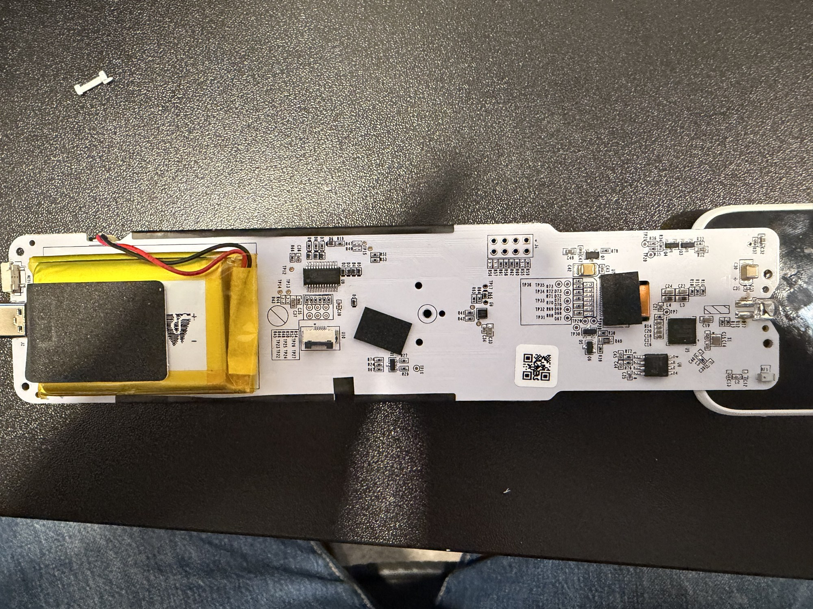
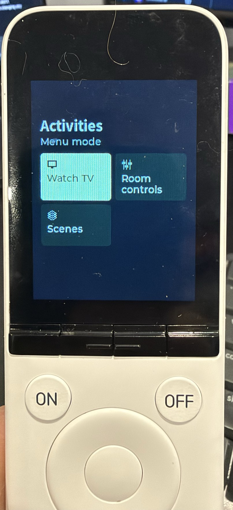
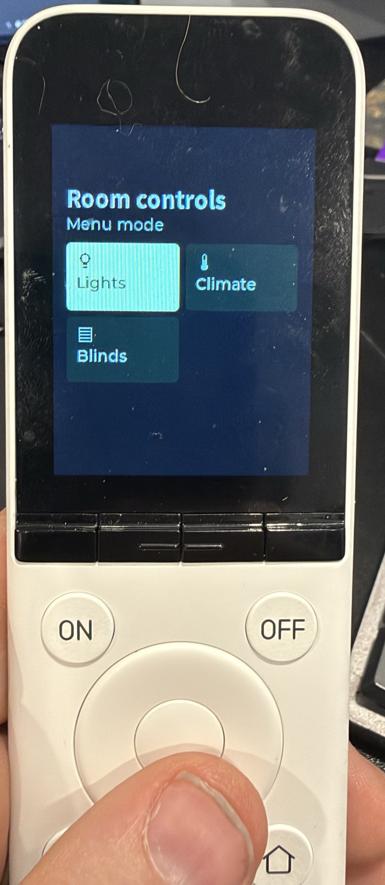
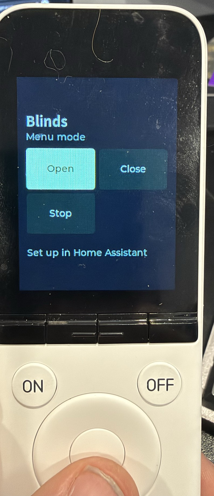
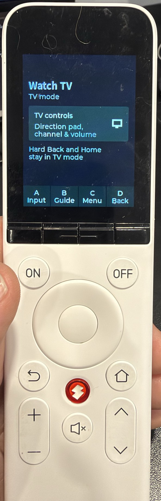

# Almost Universal

**Making the SwitchBot Universal Remote live up to its name.**

We're turning a SwitchBot Universal Remote (W4600000) into a Home Assistant activity remote. The handset runs its own menus and sends button presses to Home Assistant over Bluetooth. Home Assistant stores the action bindings and provides a draft editor for future editable handheld screens.



## Current hardware milestone

The V06 spare runs **Almost Universal**, a custom DSP menu alongside stock v4.8 ARM Bluetooth and recovery firmware. Physical buttons controlled an office light, a fan, a blind, paired curtains, and Vizio volume and mute through Home Assistant Bluetooth with MQTT off. A follow-up build displayed the compact Activities header and the stock battery icon. [November 20 progress and remaining work](docs/progress-2026-11-20.md) · [Bench evidence](docs/first-hardware-milestone.md#current-evidence)

| Activities | Room controls | Blinds | Watch TV |
| --- | --- | --- | --- |
|  |  |  |  |

These bench photos show screen development during the session. The later Office build added separate Blinds and Curtains pages under Covers and a Fan page.

## Try the offline tools

Use Python 3.11 or newer for the OTA CLI. ZIP inspection and the uploader's unit tests use the standard library. The dependencies below enable BLE scanning and serial capture. The [DSP source builds](firmware/dsp-v48-native-menu/patches/README.md) list their own tooling and rebuild the tested menu from a local stock v4.8 package.

```sh
python3 -m venv .venv
source .venv/bin/activate
python -m pip install -r requirements.txt
python -m unittest -v test_worws_ota
python worws_ota.py inspect /path/to/WoRWS_freq_app_V48.zip
```

On macOS, run `python worws_ota.py scan --normal` to find a running remote or `python worws_ota.py scan` to find one already in recovery mode. SwitchBot's app recovery clears previously synced devices. [SwitchBot firmware recovery](https://support.switch-bot.com/hc/en-us/articles/25438735905943-How-to-Recover-the-Firmware-of-SwitchBot-Universal-Remote)

## Build menus in Home Assistant

Copy `custom_components/ununiversal_remote` into your Home Assistant config directory under `custom_components` and restart Home Assistant. Add **Almost Universal** under **Settings → Devices & services → Add integration**, then open **Remote Menus** in the sidebar. Use **Fixed bindings** for the stock-ARM bench profiles. **Menu builder** saves, imports, exports, and previews draft layouts in Home Assistant. Pushing those drafts to the stock-ARM handset remains in development.

Home Assistant can use an existing Bluetooth adapter or active proxy. For the stock v4.8 ARM bench setup, identify the spare and select a matching fixed profile. Bluetooth works independently of MQTT. [Stock handheld setup](docs/stock-handheld-ha.md)

For testing over MQTT, configure Home Assistant’s MQTT integration and install `paho-mqtt` in a local Python environment to run the simulator.

```sh
python -m pip install paho-mqtt
python tools/simulate_remote.py mqtt.example.local living_room --username your-user
```

You can also add this repo as a HACS custom repository of type **Integration**. The Office hardware test used integration 0.1.4. The 0.1.6 source here was tested offline against Home Assistant Core 2026.11.2. [Setup, MQTT contract, and testing](docs/remote-design.md) · [HACS custom repositories](https://www.hacs.xyz/docs/faq/custom_repositories/)

## Explore the project

- [Almost Universal handheld design guide](docs/handheld-menu-spec.md)
- [First Home Assistant hardware milestone and recovery checklist](docs/first-hardware-milestone.md)
- [Teardown photos, UART findings, and the complete U6 flash map](docs/hardware-and-dumping.md)
- [Stock image analysis, Bluetooth uploader, and custom firmware experiment](docs/firmware.md)
- [Replacement ARM firmware, build instructions, and emulator test](firmware/v06/README.md)
- [Home Assistant integration, menu preview, and transport](docs/remote-design.md)
- [SHA-256 manifest for the reference downloads](docs/SHA256SUMS)

The repository contains project-authored tools, notes, and bench photos. Vendor ZIPs, modified binaries, device dumps, and raw logs stay local.
