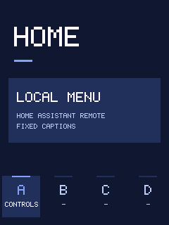
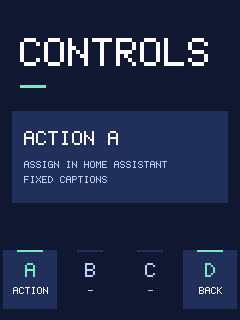

# First Home Assistant hardware milestone

The November 20 bench session ended with the Office controls tested on the spare, followed by a compact Activities header with a visible stock battery icon. [Latest results and open checks](progress-2026-11-20.md)

The target is a W4600000 REV V06 running stock v4.8 ARM Bluetooth firmware and a stock-based DSP display build. The first two-screen build left the panel blank. The DSP-only **LCD CHECK** image showed the stock display and confirmed app entry. The next build uses the stock label and native event path to check local navigation and pickup-only wake. The eventual color menu uses fixed captions and keeps action bindings in Home Assistant. [Native menu trial](../firmware/dsp-v48-native-menu/README.md)

## Controls A bench behavior

| Input | Expected behavior |
| --- | --- |
| Boot from the no-devices state | Show the **Almost Universal** splash until the first eligible button press or about three seconds. Then show **Home** with labels aligned to the four soft keys. The dismissing press opens Home and triggers no action. Keep a usable local menu while Bluetooth is unavailable. |
| Home → Controls | Press the soft key labeled **Controls** to open the second screen. |
| Controls → Home | Press the soft key labeled **Back** to return to Home. |
| Controls → Test action | Configure the labeled soft key in **Remote Menus** to toggle a disposable Home Assistant helper. One fresh press toggles it once. Holding and releasing add no calls. A second fresh press restores its starting state. |
| Power and recovery | Use the stock physical power and recovery controls. Check KATA + Reset by advertisement and visible behavior before the next upload. |
| Reconnect | Resume receiving fresh events without replaying an earlier press. |

The A-marker build verified the stock Bluetooth relay on the spare. Once the display path passes, the next two-screen trial starts with local navigation and then checks versioned outbound frames. Dynamic captions and layout updates require a separate inbound path and remain open.

These 240 × 320 previews came from the offline renderer fixture. They are bench layouts for validating navigation and actions. The prototype stores the action bindings in Home Assistant and uses fixed captions on the handheld. [DSP build and protocol](../firmware/dsp-v48/README.md) · [Home Assistant setup](stock-arm-ble.md)

| Home | Controls |
| --- | --- |
|  |  |

## Approved menu implementation

The approved Almost Universal design uses a local two-column cursor menu and a device mode. Physical Back restores the parent cursor in menu mode. In device mode physical Back and Home belong to the device, soft A–C are assignable shortcuts, and soft D goes back locally even offline. The first press used to enter a mode is consumed, including hold and release. The firmware and Home Assistant editor and preview should share these rules. Start with the stock display path and verified outbound Bluetooth events. Live state and editable handheld captions depend on a verified inbound path. [Approved handheld menu spec](handheld-menu-spec.md)

Bench order is passive stock recovery verification, a repeatable Controls A action with the existing DSP image, then a DSP-only trial of the approved menu after offline verification. Display sleep investigation is deferred.

The graphical DSP candidate adds two-column tiles, a lime focus fill, and aligned TV soft-key captions within the original 112-sector DSP range. The matched Home Assistant 0.1.3 profile accepts the TV reports and preserves the Controls A binding as a fallback. The first live action uses TV A and a disposable switch. The candidate starts at Activities, uses the stock font, and stages menu action tiles without live bindings. [Graphical DSP build and checks](../firmware/dsp-v48-native-menu/HANDHELD.md) · [Home Assistant bench setup](stock-handheld-ha.md)

The reusable live-state design gives the active screen an initial Home Assistant snapshot and updates it when relevant entities change. The read-only Climate proof uses `climate.home.current_temperature` and Home Assistant’s unit. The same contract covers later light, cover, fan, and other state fields. The logical exchange passed offline tests. Recurring traffic into DSP RAM still needs a verified inbound carrier. [State model and status](handheld-state-plan.md)

## Combined DSP retirement and visual trial

The combined candidate uses the factory display constructor’s space, retires the vendor Audio and Fan fallback pages and the `dump_AirConfig` printout, and retains the tiny shell demo as a shared return stub. It preserves stock ARM and RES, boot, power, recovery, input dispatch, TV reports and shared IR configuration. The last physically verified color candidate remains the recovery comparison. [Combined build and candidate details](handheld-combined-cut.md)

Before upload, verify the exact changed intervals and repeatable candidate digest, reconcile indirect entry points, and test the stock calls into each retired region. Verify the approved four-color splash pixel by pixel, its timeout and key dismissal, focused icons and text fit, nested Back and TV D, and unchanged TV report bytes. After a normal app-origin DSP transfer passes CRC, leave the spare untouched while the uploader closes recovery GATT and waits for normal Bluetooth. If normal Bluetooth returns, wake the display as needed and check the new screen. Record any manual intervention after the wait separately. Check both splash dismissals and the live TV A action with the existing Home Assistant binding, then verify KATA + Reset by red icon and passive advertisement. Plain Reset should return from that physical recovery check to the candidate menu with stock ARM responding as v4.8. Check physical screen readability and alignment against the [approved UI](handheld-menu-spec.md) and [artwork budget](handheld-asset-budget.md).

Review the linked instructions in changed DSP code for optional Xtensa operations. If an operation is absent from the stock listing and its support on this core is unverified, use an equivalent stock instruction sequence where practical. The first correction replaced both uses of `MUL16U`, which Cadence lists as optional. [Xtensa ISA manual, section 4.3.4](https://login.cadence.com/content/dam/cadence-www/global/en_US/documents/tools/silicon-solutions/compute-ip/isa-summary.pdf)

### Resume the spare test

1. The operator reported a working menu with icons on the spare running the 12-byte stock-instruction correction. Use this image for the next bench checks. Splash appearance and timing still need a separate observation.
2. Check splash timeout and early dismissal on separate boots. Confirm nested icons and focus, title and label fit, and TV soft D offline. Check for one Home Assistant event and one switch transition per fresh configured TV A press. After reconnect, check for no action before the next press and one transition after it. Close with passive KATA entry and plain Reset back to Activities. [240 × 320 visual reference](handheld-combined-acceptance.md)
3. If the blank panel recurs, collect receive-only DSP_TX if the adapter is available. The **First-Activities** control keeps the two instruction fixes and relocated menu, skips splash and decorative objects, and preserves the TV event bytes. If it draws, the splash-bypass build can then test the decorated menu with splash still disabled. A separate UART phase-trace image can narrow a splash-specific failure once app-rate capture is confirmed.
4. If First-Activities still comes up blank, use the pinned color DSP through the verified normal app-origin updater while stock ARM still answers. A full stock recovery is a separate restore path.

Run the first working display and TV A check against the deployed 0.1.3 integration. The separately staged action patch addresses reconnect and unload races. Test that patch with the same button binding after establishing a repeatable display and action baseline. [Offline integration checks](handheld-offline-reliability.md)

### Office controls bench checks

The Office DSP adds Lights and Fan under Room controls and separate Blinds and Curtains screens under Covers. Almost Universal 0.1.4 accepts their press reports alongside the earlier Watch TV reports. Set each action against its intended Home Assistant entity. Check that entering a device screen, holding or releasing a key, and returning with Back produce no device action. Keep the working stock-instruction DSP and the full stock v4.8 restore package available.

Test the main lights and fan with one toggle each and a fresh toggle to restore their starting state. Test the blind and the paired curtains as distinct controls. Use Open, Close, and Stop against the documented cover features and record the state of each curtain motor. In Watch TV, check Volume Up, Volume Down, and Mute once each against the saved Vizio bindings. On reconnect, verify that the first new press produces one action. Check passive KATA recovery and return to normal Activities before considering the image ready for routine use.

### Editable menus and live state

The Office and compact-header builds have fixed DSP screens and Home Assistant action bindings. The next bench work uses that working setup as the comparison for the display, editor, and data transport.

The shared-header DSP and Home Assistant 0.1.5 Menu Builder are staged offline. The graphics build reuses the stock battery feed across all ten Office screens and trims the TV screen to its icon and key captions. The editor saves and previews custom drafts independently of the fixed bindings. The offline menu fixture applies the editor's exact device projection and checks Back, state freshness, and routing to distinct targets. [Shared-header firmware](../firmware/dsp-v48-native-menu/patches/README.md) · [Menu Builder and test steps](handheld-menu-draft-v1.md) · [Native display reference](handheld-office-display.md)

| Work | Acceptance check |
| --- | --- |
| Shared layout | Activities, nested menus and device pages use the compact title and the same top-right battery position. Real stock battery reports update each open page. The title, status, and A–D captions fit. Watch TV leaves space for current media and keeps the verified action keys. |
| Home Assistant menu authoring | Create a menu and a device page, link them, choose state fields and button actions, save, and reload. The preview follows the same Back and focus behavior as the handheld. Editing a draft preserves the live Office bindings. |
| Multi-device activity | On one Watch TV page, direct the navigation pad to Apple TV, volume and mute to an AVR, and an assignable Power action to a Home Assistant script for the TV, Apple TV, and AVR. Check an individual key override and a separate automation trigger with conditions enabled. Physical ON, OFF, and KATA keep their stock roles. |
| Climate and device status | Show measured room temperature and the separate target. Increase and decrease the confirmed target using the thermostat's reported step and limits. Show fan and light power, supported fan speed, cover position or motion, and unavailable or last-known values. The first live transport check is one verified Climate reading. |
| Menu delivery | Apply a validated saved revision as menu data over the existing Bluetooth session after both endpoints advertise support. Check that an interrupted transfer or an invalid link leaves the last usable menu available. Home Assistant keeps the saved configuration. On a fresh DSP start, the local menu is available while the link restores the selected revision. |
| Now playing | Show the confirmed program title and art from the configured playback entity, such as Apple TV when it exposes the artwork. Use the current input or app name when that is the available Vizio data. Confirm that the displayed content clears or becomes stale when its source changes or disconnects. |

The experimental URM1 implementation already provides a versioned menu transfer and commit model. The stock ARM v4.8 profile needs a verified return path before it can use that pattern for a DSP menu. Confirm independent ARM recovery before a physical relay trial. [Existing menu transport](remote-design.md#bluetooth-wire-contract) · [Editable menu draft contract](handheld-menu-draft-v1.md) · [State and recovery plan](handheld-state-plan.md)

Home Assistant runs the chosen automation with `skip_condition: false`. Use a script for an activity sequence whose behavior should be the same wherever it is invoked. Manual automation triggers lack the data supplied by their original trigger. [Trigger automation](https://www.home-assistant.io/actions/automation.trigger/) · [Apple TV artwork source](https://github.com/home-assistant/core/blob/2026.11.2/homeassistant/components/apple_tv/media_player.py#L402)

## Bench sequence

1. **Identify the spare and establish the baseline.** Record the hardware revision, normal Bluetooth identity, firmware version, battery state and visible display. Keep both the experimental DSP package and the original complete v4.8 recovery ZIP locally. Verify each archive's digest and member list. Match the stock ZIP against the [reference manifest](SHA256SUMS).
2. **Check entry to stock recovery with a passive Bluetooth scan.** On the bench remote, hold KATA and briefly tap recessed Reset. Record the red icon and matching `WoRws_D` advertisement. Treat any OTA command after physical entry as part of a full restore, since the first command can trigger the stock erase. [SwitchBot recovery procedure](https://support.switch-bot.com/hc/en-us/articles/25438735905943-How-to-Recover-the-Firmware-of-SwitchBot-Universal-Remote)
3. **Run the pinned native menu through normal update entry.** Reuse the app-origin handoff that passed for the display checkpoint. Record **Home**, A onto **Controls**, and D back to **Home**. After confirmed sleep, verify pickup-only wake and Down-button wake in separate passes. The existing DSP_TX markers are available for startup diagnosis. [Exact ZIP and wake tests](../firmware/dsp-v48-native-menu/README.md#bench-handoff)
4. **Select the rollback for the observed state.** When normal app-origin update still works, a pinned known-good DSP restores the display without transferring ARM or RES. When complete stock recovery is needed, use the complete stock v4.8 package, then verify normal-mode v4.8 and a working display. A stock unit with no configured devices may show the setup screen. SwitchBot’s documented recovery clears previously synchronized devices. [Stock restore and DSP test history](firmware.md#bluetooth-recovery-uploader)
5. **Check outbound v1 when the relay is added.** Record the source screen and key ID for each tap and check for extras on hold, release, or reconnect. Use a disposable helper when exercising a Home Assistant action. Verify stock sleep/wake and the passive recovery entry on that build. [Versioned input protocol](../firmware/dsp-v48/PROTOCOL.md)

## Current evidence

| Check | Status |
| --- | --- |
| Normal-mode baseline | The spare answered a normal Bluetooth version query with v4.8. A passive four-second window contained zero A markers. The operator confirmed a working stock display. The reported battery level before the transfer was 96%. |
| Baseline recovery entry | KATA + Reset produced the red recovery icon and the spare's matching `WoRws_D` advertisement. The first stock destination probe disconnected at the ARM chip query, before the host sent a dedicated erase command. The retry confirmed ARM `0x54000`, DSP `0x00000000`, and RES `0x00100000`. The candidate probe confirmed DSP `0x00000000`. The v4.8 recovery handler can start an external erase during a query. |
| Complete stock v4.8 Bluetooth rollback | Previously demonstrated on the V06 spare. Normal Bluetooth and the stock display returned. |
| Modified DSP with stock ARM | Previously demonstrated with the charging-screen label test. That transfer included stock RES and ARM alongside the modified DSP. |
| DSP-only soft A package | Rebuilt byte for byte from stock v4.8. The emulator observed two sends for two fresh A presses and zero extra sends. Package SHA-256 is `fae96b9b43e8917b81f0a56ffcc4a2fa305e0b2d07ecdc2c2422990c6e975fff`. |
| First A trial through physical recovery | DSP-only transfer reached 100% and received `00 14 04 00`. The spare remained in recovery until a manual Reset. In normal mode the ARM reported v4.8 and the display was blank with the backlight on. The Bluetooth event listener disconnected with zero matching A markers captured. DSP execution was unverified in this run. |
| Blank-screen follow-up | The stock v4.8 ARM can schedule an external-flash erase on the first OTA command after KATA + Reset. Display resources fall in that erase range. This is the leading explanation for the blank screen, with the actual erased sectors unobserved. The uploader blocks recovery probes and DSP-only writes before connecting. |
| Stock DSP startup reference | During an ordinary Reset with KATA released and a Down wake, the receive-only UART at 115200 8N1 captured 78 bytes including `BOOT: start up.`, three `freqchip` strings, and `DSP basic function start running.` The operator confirmed the working stock **No Devices** screen after Down. Normal Bluetooth reported v4.8 and 100% battery. [Wiring, stock UART route and offline marker](../firmware/dsp-v48-uart/README.md) |
| App-initiated DSP-only label test | The spare entered the updater through its normal Bluetooth service. The checked transfer sent only a same-length DSP image with nine changed label bytes. After the CRC acknowledgment and return to normal v4.8 Bluetooth, the operator saw **DSP ready. Please add devices via app.** The working screen establishes physical activation through this path. A subsequent KATA + Reset showed the red icon and recovery advertisement, followed by normal advertising. That check used a passive scan. |
| A candidate through normal Bluetooth update entry | The identical A-marker package was transferred through the app-initiated path. After Reset and Down, the stock setup screen worked, the DSP startup trace was recorded, and the ARM reported v4.8. Two fresh A presses produced exactly two matching Bluetooth notifications, with no extras during hold or release. |
| First two-screen display trial | The pinned menu DSP passed the app-origin transfer CRC. After Reset and Down, stock ARM Bluetooth and the complete DSP loader trace returned. The operator saw a lit backlight with no image. The two-screen navigation and key behavior remain unverified. |
| Stock-renderer display checkpoint | A separate DSP-only diagnostic drew **LCD CHECK** on the spare. The ESP8266 captured `DSP:E` at 115200 8N1 after the stock loader banner. The firmware session is building the next menu around the working stock render path. [Checkpoint design](../firmware/dsp-v48-display-check/README.md) |
| Native Home/Controls trial | The exact stock-renderer navigation image passed the DSP-only transfer CRC. Normal v4.8 Bluetooth returned, `DSP:E` appeared on DSP_TX, and the operator confirmed A opened Controls and D returned to Home. After idle sleep, pickup did not wake the screen. Down brought the menu back. Stock motion-wake gating is under investigation. [Native trial design](../firmware/dsp-v48-native-menu/README.md) |
| Recovery after the first A trial | KATA + Reset brought back the red recovery icon. The first restore connection disconnected during the ARM chip query. The retry restored stock RES, DSP, and ARM in that order. All three final acknowledgments arrived, normal Bluetooth reported v4.8, and the operator confirmed the working stock **No Devices** screen. Independent wired ARM recovery remains unverified. |
| Stock-ARM Home Assistant transport and two-screen DSP build | The simulated Home Assistant test saved an A binding through the GUI and toggled a simulated switch once for each fresh marker with MQTT disabled. The two-screen package passed the Xtensa and sanitized renderer fixtures before the blank display trial. Physical v1 input and motion wake on the menu build remain unverified. [Build and protocol](../firmware/dsp-v48/README.md) |
| Stock display checkpoint | The spare showed **LCD CHECK** and emitted `DSP:E` after the resident startup trace at 115200. [Checkpoint](../firmware/dsp-v48-display-check/README.md) |
| Almost Universal splash | The pinned DSP-only ZIP rebuilt byte for byte and passed the transfer CRC. On the spare, the splash timed out to Home in about three seconds. Holding A on a separate boot dismissed it to Home and produced no navigation on hold or release. A fresh A tap opened Controls, and D returned to Home. Normal Bluetooth reported v4.8 afterward. [Exact package and bench procedure](../firmware/dsp-v48-native-menu/SPLASH.md) |
| Pickup wake and splash replay | The bench enabled the stock Raise to Wake setting and verified the remaining read-back settings. On the Controls A image, a later key-free pickup from idle-dark Controls woke the display, replayed the splash, and produced a new resident loader banner and `DSP:E` separate from the Reset trace. Returning directly to the menu on pickup and RAM retention remain open. [Capture and next discriminator](../firmware/dsp-v48-display-check/RETENTION.md) |
| Controls A v1 | The pinned DSP-only candidate passed its transfer CRC and opened Controls with **A: Action** and **D: Back**. Two Home Assistant short-tap passes each produced two decoded events and toggled the disposable switch on → off → on. The second pass followed verified physical recovery entry and a normal Reset. Direct Bluetooth captured two distinct raw frames from two short taps and one from the separate held-then-tap sequence. The held-then-tap discrepancy remains open. [Exact package and wire contract](../firmware/dsp-v48-native-menu/ACTION.md) |
| Fully dark display timeout | The stock Auto-Dim setting read back at five seconds while the screen still took about a minute to go dark with Home Assistant disconnected. The original 15-second setting was restored and verified. One later run took about 2 minutes 15 seconds. On the single-tap repeat the screen held its brightness until it went dark at 2 minutes 12 seconds, close to the combined 15-second inactivity and 120-second sleep timers. The backlight command and DSP shutdown were not measured. |
| Physical recovery on Controls A v1 | Earlier attempts showed no red icon or recovery advertisement. On the repeat the operator saw the red icon, an advertisement-only scan matched the spare’s `WoRws_D` identity, and plain Reset returned to the same Controls screen. No recovery GATT connection or write took place. The 115200 serial capture contained isolated bytes with no decoded startup banner for this attempt. |
| Approved graphical menu on the spare | The DSP-only transfer passed its CRC. Activities rendered colored two-column tiles. Physical Back restored focus at both nested levels. TV showed the four captions, and soft D returned to Watch TV focus with Home Assistant paused. The operator found the visual treatment rough. KATA + Reset showed the red recovery icon and matching advertisement. Normal Reset returned to Activities and normal Bluetooth reported stock ARM v4.8. [Graphical DSP candidate](../firmware/dsp-v48-native-menu/HANDHELD.md) |
| Approved menu Home Assistant action | The 0.1.3 handheld profile used direct Bluetooth with MQTT off. One physical TV A tap emitted one `tv / soft_1 / press` event and toggled the GUI-configured disposable switch and helper from on to off once. Physical Back stayed in TV mode, emitted one unbound `tv / back / press` event, and caused no extra switch action. Held OK during entry and soft D during return produced no events. [Matching Home Assistant setup](stock-handheld-ha.md) |
| Corrected native palette | After the first polish showed violet and blue on the panel, a separate DSP-only build corrected the color byte order against stock fill and flush instructions. The spare showed charcoal, a lime focus, and readable labels. The existing Home Assistant 0.1.3 entry was re-enabled with its saved TV A binding and MQTT off. The operator deferred the live button and KATA retests on this build. [Polish and palette evidence](handheld-native-polish.md) |
| Combined visual and DSP retirement | The reproducible DSP image passed the exact splash-pixel, menu and stock registry fixtures and the hardware transfer CRC. Its first physical display check showed a lit blank panel. A 12-byte stock-instruction correction also passed the fixture and hardware transfer CRC. Normal Bluetooth returned on stock ARM v4.8. The operator later reported a working menu with icons. Splash behavior, the Home Assistant action, and KATA recovery remain open on the correction. [Combined design and build](handheld-combined-cut.md) |
| Visual polish palette on the spare | The initial polish image showed a violet panel and blue tiles. Watch TV was effectively unreadable, while the title and mode hierarchy, grid spacing, and two-line Room controls were visible. [Photo findings](handheld-native-polish.md#staged-polish-image) · [Palette comparison](handheld-native-polish.md#palette-comparison-from-photos) |
| Corrected Activities palette on the spare | The follow-up trial confirmed a charcoal background, lime focus, and readable labels. The exact color ZIP contains only the DSP. Screen refinements, a read-only Climate renderer, and the startup splash were sized offline against the same stock flash extent. [Corrected color build](handheld-native-polish.md#stock-color-path-and-corrected-build) · [Offline size measurements](handheld-native-visual-slice.md#firmware-budget-and-evidence) |
| Office controls with Home Assistant 0.1.4 | The fan and intended office light each toggled off and back on. Open, Close, and Stop worked on the blind and paired curtains. Both curtain motors paused in the second Stop test. On the labeled Watch TV retest, Volume +, Volume −, and Mute worked on the Vizio. |
| Compact Activities header | The DSP-only transfer passed CRC. A normal reset showed the raised Activities title and battery icon. Home Assistant reconnected with the Office and Vizio bindings intact. The post-header action and passive KATA regression checks were deferred. [Rebuild and exact archive hash](../firmware/dsp-v48-native-menu/patches/README.md) |

For each test, record the candidate and stock archive digests, tool revision, target hardware and firmware, transport, inputs, firmware or HA responses, and the rollback result. Report emulator, Bluetooth and physical display results individually. Keep vendor archives, device IDs and private Home Assistant details out of public reports.
