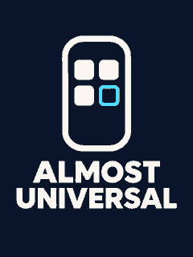

# Handheld artwork and storage budget

The 240 × 320 design can preserve the approved Almost Universal splash composition, add a consistent icon family, and carry three small menu illustrations in **21.2 KiB of packed assets**. The larger profile uses RGB565 for the menu illustrations and reserves room for code and future artwork. Both are offline budgets for a future verified asset location. [Approved screen layouts](handheld-native-visual-slice.md) · [Stock flash evidence](hardware-and-dumping.md)

## Approved artwork to reuse

- **Splash.** The approved 1,086 × 1,448 PNG is 1,216,612 bytes and matches the original splash encoder's source hash `56a3ac0cab4766aab930a9fc55076a736645a099ea97fea8ca979537a339a2a7`. Its aspect ratio is already 3:4. The [four-color 240 × 320 source](../images/handheld-splash-240-four-color.png) retains the approved mark, wordmark, and placement. It assigns palette entries to navy `#0A152A`, warm white `#FAF7F2`, cyan `#50DCFE`, and edge gray `#848890`. Three or four colors use the same 2 bits per pixel. Use the fourth entry to smooth the edges. [Original native splash evidence](../firmware/dsp-v48-native-menu/SPLASH.md#artwork-and-memory)
- **Icon family.** Reuse the approved TV, sliders, layers, lightbulb, thermometer, blinds, clapperboard, and sunset marks. Start at 16 × 16 for browse tiles and use a 24 × 24 TV mark in the Watch TV panel. Budget idle and focus mattes for each browse mark. Stack the text and icon within the existing tiles so focus and padding stay consistent.
- **Menu illustrations.** Reserve one 192 × 40 image for a Watch TV strip and two 160 × 64 images for the Movie night and Evening scenes. The Watch TV strip can sit below the device hint, at y 210–249. Scenes can share one image position at y 178–241, drawing the one for the focused scene. These are proposed art slots. Start from the approved marks and palette. Keep the Activities grid, scene labels, TV footer, and input behavior consistent with the approved design. [Placement reference](handheld-native-visual-slice.md)

## Compact splash packing

Draw one solid navy background and position three opaque 2 bpp images at their original coordinates. Use the same palette in every image. Match the background fill to the native palette conversion so the crop edges blend into the field. The packed crops reconstructed the four-color source pixel for pixel offline.

| Crop | x, y, width, height | Packed bytes with palette and descriptor |
| --- | --- | ---: |
| Mark | 77, 44, 88, 145 | 3,218 |
| ALMOST | 41, 200, 160, 28 | 1,148 |
| UNIVERSAL | 20, 233, 200, 27 | 1,378 |
| **Total** | | **5,744 (5.6 KiB)** |

The full-frame 2 bpp version takes **19,228 B (18.8 KiB)**. Combining both words into a single crop takes **6,246 B** for the two-image arrangement and saves one image object. The three-image budget leaves render code and runtime allocation to the linked build. The earlier 48 × 76 mark with a stock-font wordmark uses **940 B** for its one indexed image and descriptor. Its smaller mark and stock text change the original composition. [16-color and RGB565 reference](../images/handheld-splash-budget-preview.png)

## Two storage profiles

The figures are unpacked image bytes with each image's palette and 12-byte descriptor where applicable. Menu illustration sizes are examples based on fixed raster dimensions. The linked build must also account for code, alignment, lookup tables, and runtime allocation.

| Asset | Dimensions and variants | 64 KiB assets | 1 MiB combined profile assets |
| --- | --- | ---: | ---: |
| Full-size splash | 240 × 320, solid field and three crops | 5,744 B, indexed 2 bpp | 5,744 B, indexed 2 bpp |
| Browse and TV icons | 8 × 2 mattes at 16 × 16, one 24 × 24 TV mark | 1,644 B, indexed 2 bpp | 1,644 B, indexed 2 bpp |
| Watch TV illustration | 192 × 40 | 3,916 B, indexed 4 bpp | 15,372 B, RGB565 |
| Movie night illustration | 160 × 64 | 5,196 B, indexed 4 bpp | 20,492 B, RGB565 |
| Evening illustration | 160 × 64 | 5,196 B, indexed 4 bpp | 20,492 B, RGB565 |
| **Asset total** | | **21,696 B (21.2 KiB)** | **63,744 B (62.25 KiB)** |

- **64 KiB assets.** The proposed set leaves **43,840 B (42.8 KiB)** for packing, metadata, or alternate images. Budget code separately.
- **1 MiB combined.** Treat this as DSP application plus custom assets. Reserve **512 KiB** for the DSP application and its growth. With RGB565 menu illustrations and the compact splash, the total is **588,032 B (574.25 KiB)**, leaving **460,544 B (449.75 KiB)**. A full RGB565 splash alone takes 153,612 B if its extra tonal detail is needed. The stock v4.8 `RES.bin` alone is 4,955,264 B. The full restore package has its own sizing. [Firmware members](firmware.md)
- **Verified bench limit.** The current color candidate is 458,540 B with 212 B free before the existing `0x70000` boundary. Either asset profile needs a separately verified storage and read path. Account for its flash range, ownership, packaging, and recovery before placing assets there. [Measured DSP budget](handheld-native-visual-slice.md#offline-screen-builds)

## Decoder and RAM tradeoffs

| Format | Flash and decoder cost | Runtime check |
| --- | --- | --- |
| **Indexed 2 bpp** | Reuse the proven opaque LVGL path from the 48 × 76 splash crop, which uses 928 B of pixels and palette plus a 12 B descriptor. Keep the exact matte colors for idle and focus. | Verify simultaneous menu image objects, redraw and teardown. The earlier splash image object requested 60 B of heap before child-list, style, and allocator overhead. |
| **Indexed 4 bpp** | Sixteen BGRA palette entries use 64 B per image. Compact for the approved splash, icons, and restrained scene art. | Verify the 4 bpp native decoder and target byte order. A streaming draw can expand into an existing band if supported. A full RGB565 decode uses **150 KiB**. |
| **Opaque RGB565** | Two bytes per pixel. Preserves more tonal detail in the approved art and richer menu images. | Verify the native image source format and panel byte order. A 240 px decoded row is 480 B. Eight rows are 3,840 B, excluding existing display buffers and decoder state. A full-frame copy is 150 KiB and a second copy adds another 150 KiB. |
| **Desktop compression** | The four-color PNG is **1,812 B**. The earlier 16-color PNG is 4,005 B. | Those are file export sizes. A runtime PNG path needs verified decoder support, working memory, and draw timing before those savings count on the handheld. |

## Asset order

1. **Restore the original splash at full size.** Validate the four-color version and cropped redraw at native size. The solid navy field, off-white wordmark, and cyan accent should survive normal and dim backlight. The established splash timer and first-press behavior remain the reference.
2. **Ship the reusable icons.** Validate tile and footer alignment, focus contrast, and image object lifetime. Stage the TV, sliders, and layers marks first, then reuse the same stroke and matte rules on other menus.
3. **Add the TV and scene images.** Start with one Watch TV illustration, then Movie night and Evening. Measure linked storage, peak heap, and repaint time one asset group at a time. Check readability with the full 240 × 320 interface visible.
