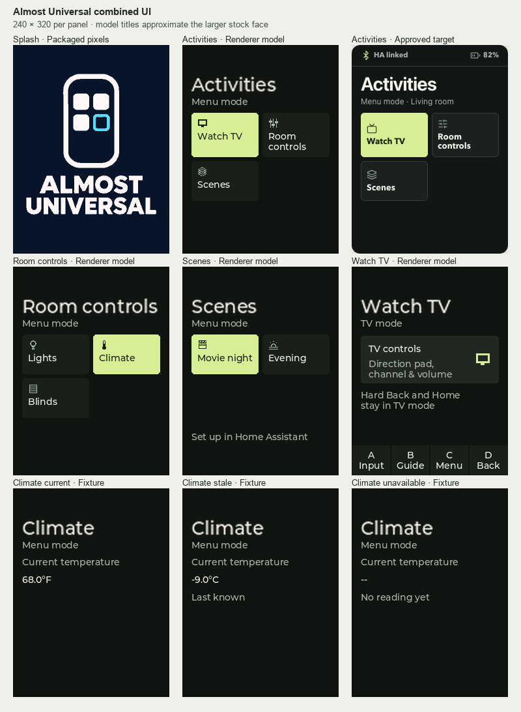

# Combined handheld UI acceptance card

Use this card to review the intended 240 × 320 output of `WoRWS-v4.8-DSP-ALMOST-UNIVERSAL-FULL-SPLASH-CUT.OFFLINE.zip`. The ZIP SHA-256 is `1455b3df730a9cc82bec00cdc5d36993b38a868002a14ec68be600bf932482f4`. Its 458,540-byte DSP reproduced byte for byte in an isolated build. [Build record](handheld-combined-cut.md#offline-build-result)

## What the images establish

| Caption on the card | Evidence and limits |
| --- | --- |
| **Packaged pixels** | Decoded from the three compressed crops and palette in the exact DSP member. The composite matches all **76,800 pixels** of the approved four-color splash at RGB565 precision. The Xtensa fixture also runs the stock indexed pixel and palette routines and checks the complete frame. |
| **Renderer model** | Uses the package's decoded indexed marks, screen labels, and compact font pixels. Positions, focus fills, and caption boxes follow the linked source and fixture geometry. The host model uses unkerned text advances and approximates the larger stock title face. |
| **Approved target** | A 240 × 320 Activities capture from the approved browser design. It shows the intended typography, outlines, and icon treatment. Battery and link indicators in this cell are example data. The [full approved reference](handheld-native-visual-slice.md) also shows Watch TV. |
| **Fixture** | Shows the combined Climate layout with the fixture's independent `68.0°F` current and `-9.0°C` stale samples, then explicit unavailable. The unavailable case clears the number to **--** and displays **No reading yet**. A live inbound temperature path remains to be verified. |

The model shows the combined build's actual icon set and simpler idle tiles. The approved target shows finer outlines and different font weight. On device, the title is assigned the larger stock menu face at `0x001CA068`. Mode, tiles, captions and the Climate readout use the compact stock face at `0x20060A70`, with a 16 px line height and 3 px baseline offset.

## Native geometry to check

Coordinates are x, y, width, height in LCD pixels.

| Surface | Linked geometry |
| --- | --- |
| Splash | Navy field and crops at `77,44,88,145`, `41,200,160,28`, and `20,233,200,27`. |
| Title and mode | `14,45,212,32` and `14,79,212,22`. Both are left-aligned. |
| Activities | Columns x 14 and 123, width 103. Row 1 at y 104, height 68. Scenes at y 178, height 61. The 16 × 16 marks sit 9 px from the tile's left edge and 8 px from its top. Tile text starts 28 px below the tile top. **Room controls** wraps deliberately. |
| Room controls and Scenes | Same columns and icon/text insets. Rows at y 104 and 171, height 61. Scenes uses the first row. Room controls shows Lights, Climate, and Blinds, while Scenes shows Movie night and Evening. |
| Watch TV | Panel `14,106,212,73`. Title text origin is x 26, y 118. Supporting text uses `26,141,152,36`. The 24 × 24 TV mark starts at x 189, y 130. The hint uses `14,189,212,36`. Caption slots are `60 × slot + 1,274,58,46`. The centers are x 30, 90, 150, and 210. |
| Climate | Label `14,105,212,20`, value `14,132,212,20`, status `14,159,212,21`. Blank footer and zero focusable tiles. |

## Physical acceptance when bench work resumes

The exact combined ZIP previously transferred and acknowledged its CRC, then showed a lit backlight with a blank panel after Reset and wake. The offline replay passed its splash, geometry, navigation, color, and TV packet checks. Confirm a visible frame before using this card to score appearance. [Blank-panel evidence and next bench checks](first-hardware-milestone.md#resume-the-spare-test)

- [ ] **First visible frame.** Record the exact test package and check that the screen draws before scoring palette or layout.
- [ ] **Splash.** Confirm the navy is continuous across crop edges, the cyan key is visible, and both wordmark lines match the approved placement. Check timeout and first-fresh-press dismissal to Activities.
- [ ] **Type and focus.** Check that the real stock title reads larger than the mode line and that **Room controls** fits without clipping. Follow the lime fill and its dark icon through Activities and the nested grids. Physical Back should restore the prior selection.
- [ ] **TV.** Confirm the controls panel and hint fit and the four stacked captions sit directly above A–D. Check physical Back goes to the TV and soft D returns locally.
- [ ] **Climate.** Confirm the read-only layout and physical Back. Once the inbound carrier is verified, compare one live current value and unit, a last-known value after link loss, and explicit unavailable clearing the value. These checks remain separate from the fixture samples.

Keep the original comparison captures in normal and dim backlight with the entire display and A–D visible. Use the same exposure across each set. [Photo comparison procedure](handheld-native-polish.md#palette-comparison-from-photos)
