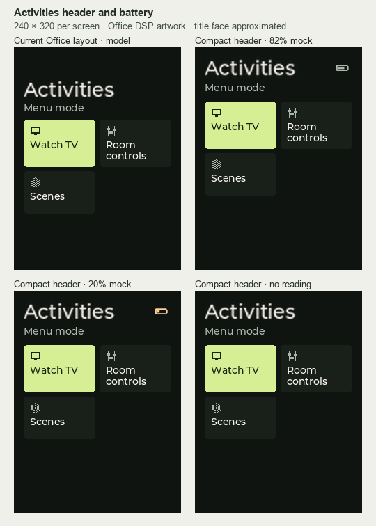

# Combined native menu design checklist

Use this checklist for the 240 × 320 combined firmware cut. The biggest visual gains are a distinct title and mode hierarchy, left-inset tiles with recognizable icons, one obvious focus fill, and a TV screen with both a controls panel and aligned soft-key labels. Preserve the approved cursor, physical Back, device key, and soft D routing. [Approved 240 × 320 reference](handheld-native-visual-slice.md) · [Control rules](handheld-menu-spec.md#controls-by-mode)

Use the [combined UI acceptance card](handheld-combined-acceptance.md) to compare packaged pixels, the renderer model, and the approved target before the next physical check.

Use the [Office display follow-up](handheld-office-display.md) for the shared header on all pages, the clean visual-only TV screen, and future Climate, device status, and activity routing.

## 1. Apply the stock font roles and palette

Coordinates below are x, y, width, height in LCD pixels. Use the existing stock LVGL font and label paths.

| Role | Font and placement |
| --- | --- |
| Screen title | Larger stock menu face `stock_menu_font` at `0x001CA068`. Left-align in `14,45,212,32`. Keep the full title on one line. The browser target is 29 px semibold. Verify actual ink fit with the native face. |
| Mode and supporting text | Stock compact face `stock_compact_font` at `0x20060A70`. It has a verified 16 px line height and 3 px baseline offset. Put the mode at `14,79,212,22`. Use compact for tile labels, glyphs, hints, feedback, captions, and the Climate readout. |
| Large readout | Compact primary text is the measured Climate baseline. The larger stock title face can also be used for a confirmed value when it fits the combined build and a 32 px value box. Keep the label and freshness text compact. |

Use the compact Activities header below for the Office controls follow-up. Other screens use the base title and mode placements. Use the approved palette across screens and convert intended RGB565 words once at the stock LVGL style boundary. Indexed image palettes follow the image encoder's BGRA path. [Verified native color path](handheld-native-polish.md#stock-color-path-and-corrected-build)

| Role | Design sRGB | Intended RGB565 | Stock setter word |
| --- | --- | --- | --- |
| Panel | `#121716` | `0x10A2` | `0xA210` |
| Idle tiles and footer | `#1A211E` | `0x1903` | `0x0319` |
| TV panel | `#202A25` | `0x2144` | `0x4421` |
| Idle outline or divider | `#353E39` | `0x31E7` | `0xE731` |
| Selected fill | `#D6EF95` | `0xD772` | `0x72D7` |
| Selected icon and text | `#1A2415` | `0x1922` | `0x2219` |
| Primary text | `#F2F3EB` | `0xF79D` | `0x9DF7` |
| Secondary text and idle icons | `#ACB5AD` | `0xADB5` | `0xB5AD` |
| Offline or error | `#FFD098` | `0xFE93` | `0x93FE` |

### Compact Activities header

The Office controls follow-up moves the Activities title **31 px up** and the grid **26 px up**. Keep the original Office navigation, packaged tile art, and 240 × 320 palette. The new header applies to Activities. Nested, TV, and Office device screens use their existing bounds. [Exact Office DSP baseline](progress-2026-11-20.md#verified-on-the-v06-spare)

| Element | New x, y, width, height | Native treatment |
| --- | --- | --- |
| Activities title | `14,14,174,32` | Left-aligned larger stock menu face in primary text. The title box has a 10 px horizontal gap to the battery slot. |
| Battery slot | `198,22,28,18` | Center one stock compact battery glyph. Each glyph is 18 × 10 px. Use secondary text for normal charge and amber at 20% or below. |
| Menu mode | `14,50,212,22` | Left-aligned compact face in secondary text. |
| Watch TV and Room controls | `14,78,103,68` and `123,78,103,68` | The two-column grid keeps 5 px corners, a 6 px gutter, and the existing charcoal/lime fills. |
| Scenes | `14,152,103,61` | Keep the fourth cell blank. Icon starts at tile x + 9, y + 8. Text starts at x + 9, y + 28, as in the first row. |
| Soft keys | y 274–319 | Blank on Activities. Device captions stay at the existing absolute positions. |

Treat an integer percentage from a verified local battery source as valid within 0–100. Use the five glyphs already in `stock_compact_font`. Keep the title bounds fixed as the reading changes. The percent labels in the preview identify mock inputs and appear outside the LCD.

| Reading | Glyph |
| --- | --- |
| 88–100% | Full, `U+F240` |
| 63–87% | Three-quarter, `U+F241` |
| 38–62% | Half, `U+F242` |
| 13–37% | Quarter, `U+F243` |
| 0–12% | Empty, `U+F244` |
| Absent or invalid | Hide the glyph. Keep the panel color across its slot. |

Reuse the compact feedback label while Activities is active, where it is currently hidden. Restore its screen-specific position, left alignment, secondary color, and visibility when leaving Activities. Validate label reuse in the TV hint, Scenes feedback, and Climate status paths. The staged successor reads the battery percentage from the existing stock ARM-to-DSP status report. [Stock report and exact header DSP](../firmware/dsp-v48-native-menu/patches/README.md)

For acceptance, compare normal and dim backlight. The title should fit within its 174 px box and leave clear space before the battery. Verify a known normal reading, a low amber reading, and an absent reading. Check that the new grid fits intact, only the focused tile is lime, and the bottom device captions still align above A–D. The preview uses exact Office tile art and compact glyph pixels with a proxy for the larger title face. It demonstrates the layout offline. Validate the real title fit and battery rendering on the panel after the source is available.

The isolated Office baseline and compact header successor each rebuilt byte for byte and passed their Xtensa fixtures. The packaged splash still matches all 76,800 approved pixels at RGB565 precision. Panel layout and battery update cadence still need hardware verification. [Header build and fixture results](../firmware/dsp-v48-native-menu/patches/README.md)

## 2. Bring back the tile and device layouts

The grid uses x 14 and 123, 103 px tiles, a 6 px gap, and 5 px corners. In browse tiles, align art and text 9 px inside the left edge. Use a 16 × 16 mark above the label with a 4–5 px gap. With the stock glyph shortcut, each glyph occupies the first compact text line. Reuse the verified left-padding call and restore alignment and padding when the slot becomes a TV caption.

| Screen | Geometry and acceptance |
| --- | --- |
| **Activities** | The compact Office follow-up uses first row y 78, h 68 and Scenes at x 14, y 152, h 61. The base layout uses y 104 and 178. Keep the Office icons above **Watch TV**, **Room controls**, and **Scenes**. Force `Room\ncontrols` so both lines fit. Compact advances are about 43 and 58 px for those two words, versus 104 px together. The fourth cell and footer are blank. Exactly one tile is lime with a dark icon and label. |
| **Room controls** | First row y 104, second row y 171, h 61. Keep Lights, Climate, and Blinds in their existing cells. Target lightbulb, thermometer, and blinds marks. Move focus without changing tile size or text position. |
| **Scenes** | Two 103 × 61 px tiles at y 104. Reuse the film glyph for **Movie night** in a stock-only build. Add an exact sunset mark for **Evening** when asset storage is verified. **Movie night** measures about 85 px in the compact face. Confirm it fits after padding. |
| **Lights and Blinds** | Once state is available, use a readout at `14,104,212,55` and place action tiles below it. The approved Lights tile starts at `14,169,103,61`. Blinds uses a compact grid with row tops 169 and 204 and 29 px tile height. Fit a compact inline action glyph and label on one line in the shorter tiles. Keep the existing configured actions and setup feedback in the bench build. |
| **Watch TV** | Controls panel `14,106,212,73`, radius 4. Place a primary **TV controls** at x 26, y 118, then secondary `Direction pad,\nchannel & volume` at x 26, y 141. The two compact lines measure approximately 100 and 128 px inside 152 px. Place a 24 × 24 lime TV mark near `189,130` when available. Wrap the hard Back and Home hint into two lines near `14,189`. Its single-line stock width is about 247 px. Reserve y 253–273 for feedback. |
| **TV captions** | Four `58 × 46` slots at `x = 60 × slot + 1`, y 274. Center `A\nInput`, `B\nGuide`, `C\nMenu`, and `D\nBack` with 7 px top padding. The labels measure 39, 42, 41, and 36 px. The 2 px gaps separate the slots. A lime letter and primary action label are the reference treatment when per-line coloring is verified. Apply the approved shared primary color in the stock two-line probe. |

### Icon set for this cut

- **Stock glyphs first.** The compact font contains film `U+F008`, gear `U+F013`, and list `U+F00B`. The shaped ink is about 14 px wide. These three stand in for the approved TV, sliders, and layers marks in the measured build. For Lights and Blinds actions the available stock glyphs are power `U+F011`, up `U+F077`, down `U+F078`, and stop `U+F04D`. Movie night can reuse film.
- **Exact nested marks next.** Prioritize lightbulb, thermometer, and blinds for Room controls, then clapperboard and sunset for Scenes. Five 16 × 16 opaque indexed assets in idle and focused versions take **920 B** with their palettes and descriptors. Use the approved browse icons' visual style. Apply dark ink on lime for focus and muted ink on dark for idle.
- **Full icon set.** Replacing the three Activities substitutes with the approved marks and adding the larger TV mark brings the full indexed set to **1,644 B**, before code, alignment, and image object RAM. Validate image reuse and teardown on the menu page. [Artwork budget and format](handheld-asset-budget.md#two-storage-profiles)

## 3. Keep Climate read-only

Use **Room controls → Climate**, the physical Back path, zero action tiles, and a blank footer. Render the label **Current temperature** at `14,105,212,20`, the value in primary text at `14,132,212,20`, and freshness in secondary text at `14,159,212,21`. If a later pass uses the larger value face, use a 32 px value box and move freshness to y 174 so the text clears.

Use `climate.home.attributes.current_temperature` with its reported unit. The stock compact font contains the degree glyph. Show **--** and **No reading yet** before a valid sample. Show the reading and unit with a blank status once fresh. After link loss show the retained reading and unit with **Last known**. For an explicit unavailable field, clear the numeric display as specified in the state plan. Keep the existing physical Back and focus restoration. [Read-only state contract](handheld-state-plan.md#read-only-exchange) · [Layout samples](handheld-native-polish.md#read-only-climate-for-the-first-two-way-test)

## 4. Include the approved splash and verify the linked build

Use the exact [four-color 240 × 320 splash](../images/handheld-splash-240-four-color.png), SHA-256 `9ef6c703149eaccc16ee07a4c1d402f24e4a565ddf0a4eded836e144c4a33554`. Draw a solid navy field and use three opaque 2 bpp crops. The palette order is navy `#0A152A`, warm white `#FAF7F2`, cyan `#50DCFE`, and edge gray `#848890`.

| Crop | x, y, width, height | Bytes including palette and descriptor |
| --- | --- | ---: |
| Mark | 77, 44, 88, 145 | 3,218 |
| ALMOST | 41, 200, 160, 28 | 1,148 |
| UNIVERSAL | 20, 233, 200, 27 | 1,378 |
| **Total** | | **5,744 B (5.6 KiB)** |

Keep the existing timed or first-fresh-press dismissal to Activities and consume the dismissing press. Match the navy fill to the decoded matte. The measured glyphs, stacked captions, and Climate placeholder already fill the original **458,752-byte** DSP extent in combination. Read-only inbound state, the fuller TV panel, exact icon assets, and the approved splash need their combined linked size checked against verified storage. The splash and full icon assets alone total **7,388 B**, before code, alignment, and LVGL object RAM. [Measured firmware probes](handheld-native-visual-slice.md#offline-screen-builds) · [Verified crop packing](handheld-asset-budget.md#compact-splash-packing)

Before a physical test, verify the final title and longest labels, palette conversion, exactly one focus indicator, TV key alignment, Climate missing/fresh/stale rendering, and the existing navigation and TV packet fixtures. Confirm the splash crops reconstruct the approved source at their exact positions. Save a native-size reference capture for each screen to compare with the actual LCD.

## Offline build result

The combined DSP fits in 112 sectors. The 2,057-byte packed splash expands into the three exact native crops. The Xtensa fixture used stock palette and indexed scan-line instructions and matched all 76,800 panel pixels to the approved artwork at RGB565 precision. Timeout, first eligible press, release, KATA/ON/OFF delegation, and the landing on Activities passed in the same fixture.

The build uses 16 × 16 indexed marks on Activities, Room controls and Scenes, and a 24 × 24 Watch TV mark. The small bitmap marks are drawn to the design's shapes and color roles. Watch TV has separate title and supporting text, with stacked captions in one text color. Climate retains its compact readout, with missing, fresh, and last-known values exercised using fixture input. Live Climate transport and the proposed TV and scene illustration strips are separate work.

The offline ZIP is `WoRWS-v4.8-DSP-ALMOST-UNIVERSAL-FULL-SPLASH-CUT.OFFLINE.zip`. Its sole member is a 458,540-byte DSP with FreqChip CRC `278400de`. The combined profile trades the interactive factory screen and native Audio and Fan fallback screens for compact notices, and retires the `dump_AirConfig` printout. The peak accounted splash heap requests total 6,104 bytes before stock allocation overhead. Test the available heap and panel on the spare separately. [DSP source and build replay](../firmware/dsp-v48-native-menu/patches/README.md)
