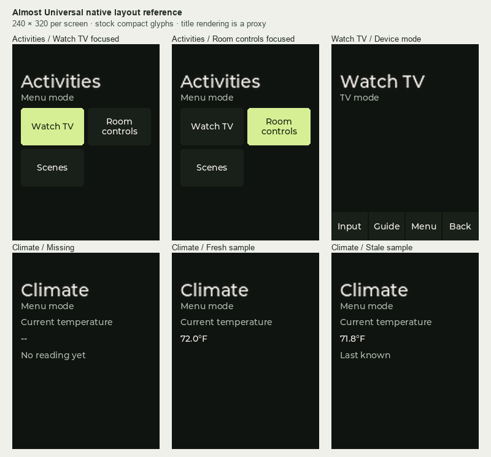

# Native display release baseline

Use this 240 × 320 baseline for the next Almost Universal layout. The spare has displayed the original colored Activities grid. The updated layout below is an offline reference and needs a physical screen check. [Design guide](handheld-menu-spec.md) · [Pinned bench candidate](../firmware/dsp-v48-native-menu/HANDHELD.md#rebuild-offline)



The reference uses compact glyphs from the stock v4.8 DSP with unkerned advances. Titles use an enlarged proxy for the stock menu face. Fresh and stale temperatures are illustrative.

## Firmware constants

Use the existing LVGL objects. Coordinates are native pixels from the LCD origin. `col`, `row`, and `slot` start at zero.

| Element | x, y, width, height | Style |
| --- | --- | --- |
| Header reserve | 0, 0, 240, 33 | Panel color until verified status is available. |
| Title | 14, 45, 212, 32 | Primary text, left-aligned, stock menu face. |
| Mode | 14, 79, 212, 22 | Secondary text, left-aligned, compact face. |
| Menu tile | `14 + 109 × col`, `104 + 67 × row`, 103, 61 | Radius 5. Center the compact face with top padding 22 for one line and 14 for the two-line `Room\ncontrols` tile. Keep the full Room controls screen title on one line. |
| General feedback | 14, 253, 212, 21 | Compact face. Existing visibility rules. |
| TV caption | `60 × slot + 1`, 274, 58, 46 | Radius 0, centered compact face, top padding 15. The 2 px gutters preserve centers at 30, 90, 150, and 210. Menu mode has a blank footer. |

The stock compact face has a 16 px line height and a 3 px baseline offset. **Room controls** measures about 104 px before kerning, so use the explicit line break on its tile. **Input**, **Guide**, **Menu**, and **Back** measure 39, 42, 41, and 36 px respectively. The [Activities and Watch TV visual target](handheld-native-visual-slice.md) defines the fuller treatment and its asset budget.

| RGB565 role | Value |
| --- | --- |
| Panel / idle tile and footer fill | `0x10A2` / `0x1903` |
| Focus fill / focus text | `0xD772` / `0x1922` |
| Primary / secondary text | `0xF79D` / `0xADB5` |

Expanded RGB565 gives calculated sRGB text contrast of **16.8:1** for the title, **8.9:1** for secondary text on panel, **15.1:1** for idle tiles and captions, and **12.8:1** for focus text. The LCD and backlight still need a physical check.

## Read-only Climate for the first two-way test

**Room controls → Climate** stays in Menu mode. Physical Back returns to Room controls with Climate focused. The readout uses the panel background, with a blank footer and zero focusable tiles.

| Element | x, y, width, height | Text and style |
| --- | --- | --- |
| Reading label | 14, 105, 212, 20 | **Current temperature**, secondary compact text, left-aligned. |
| Value | 14, 132, 212, 20 | Primary compact text, left-aligned, with the unit when known. |
| Reading status | 14, 159, 212, 21 | Secondary compact text, left-aligned. |

The Home Assistant source for this test is `climate.home.attributes.current_temperature`. Display the configured temperature unit with the reading. Apply these display states to the latest valid sample.

| State | Value | Status |
| --- | --- | --- |
| Missing | `--` | **No reading yet** |
| Fresh | For example, `72.0°F` | Blank |
| Stale | Retain the last value and its unit. | **Last known** |

Keep an existing sample stale after a disconnect or unavailable source until a valid update arrives. The first two-way test is read-only. Cursor keys, OK, and A–D produce no action on this screen, and there are no setpoint, mode, or power controls. The staging patch renders the missing state. A verified inbound Home Assistant update path is required to show fresh or stale readings on the handheld.

## Physical acceptance

- [ ] At normal and dim backlight, the title reads first and clears the smaller mode line.
- [ ] Activities shows one lime tile. Move focus between Watch TV and Room controls. Both lines of Room controls fit in either state, the previous tile returns to charcoal, and the fourth cell stays blank.
- [ ] Watch TV shows all four captions fully aligned over the physical keys. TV hard Back still goes to the TV. D returns locally to Activities.
- [ ] Climate shows **No reading yet** until data arrives. Once the inbound path is verified, check one fresh value and the **Last known** transition. The value, unit, and status fit together. Physical Back restores focus on Climate.
- [ ] Capture full-panel photos of Activities in both focus positions, TV, and Climate, with A–D visible. Use the same camera exposure for each comparison.

## Staged polish image

**Bench report.** Activities rendered on the pinned `WoRWS-v4.8-DSP-ALMOST-UNIVERSAL-POLISH.OFFLINE.zip`. The operator saw a pink background and blue buttons. The first local photo confirms a violet panel and blue tiles. The raw bench photo stays local.

- **Palette and readability fail.** The default Watch TV tile blends with the idle fills and its label is effectively unreadable in the photo. Flat camera samples were approximately `#7459D8` for the panel, `#2154E3` for Watch TV, and `#0A52E0` for idle Room controls. Treat those as camera samples under one exposure.
- **Geometry and type look sound in this view.** Activities is visibly larger than Menu mode. The header clears the tiles, the grid has even spacing, Room controls wraps onto two visible lines, Scenes fits, and the fourth cell stays blank. Watch TV label fit, focus movement, the TV footer, and dim-backlight readability still need a physical check.

### Palette comparison from photos

1. Photograph **Activities** straight on, first with **Watch TV** selected and then with **Room controls** selected. Keep the full LCD in frame. Lock exposure and white balance across the pair if available, and avoid flash and glare. Check the labels directly on the remote at normal and dim backlight.
2. Compare the same flat areas in each photo with the [native reference](../images/handheld-native-baseline.png). In LCD coordinates, sample near **(230, 230)** for the panel, **(26, 114)** inside Watch TV, and **(135, 114)** inside Room controls. Stay clear of text and rounded corners. Use the median of a small patch if sampling pixels. Camera RGB values are approximate.
3. Pass when the background reads charcoal, the idle tile is dark, and exactly one lime fill follows focus. The selected text should read dark on lime and idle text light on charcoal. Confirm **Room controls** and the mode line are easy to read in both focus states.

| Region | Approved RGB565 and approximate sRGB | If the two bytes are reversed |
| --- | --- | --- |
| Panel | `0x10A2`, `#101410` charcoal | `0xA210`, `#A54184` pink-purple |
| Idle tile | `0x1903`, `#192019` dark charcoal | `0x0319`, `#0061CE` blue |
| Focused tile | `0xD772`, `#D6EF94` lime | `0x72D7`, `#7359BD` purple-blue |

The reversed-byte model predicts the reported panel and idle color families. The first photo shows the focus and idle fills close together. A second focus position can confirm the visible change, and the firmware trace is needed to establish the conversion.

**Offline verification.** The [staging patch](../firmware/dsp-v48-native-menu/handheld-climate-preview.patch) was tested in a temporary source copy. Xtensa/QEMU verified styling, geometry, read-only Climate navigation, and TV packet routing. The design-only DSP builds to **458,712 bytes**, leaving **40 bytes** before `0x70000`. The legacy `--handheld-layout` build reproduced the installed candidate ZIP byte for byte. The staged patch carries the display baseline for the firmware workstream. Track the inbound implementation and on-device checks separately.

## Stock color path and corrected build

In exact stock v4.8, the LVGL background setter at `0x2003a1b4` and text setter at `0x2003a23c` store the caller’s 16-bit value before calling the style writer. The stock default background branch at `0x2003f5c9` constructs white, `0xffff`. Its identical bytes explain why white alone cannot identify their order.

The direct panel fill at `0x20006230` stores the high byte of RGB565 at pixel offset 0 and the low byte at offset 1. The stock LVGL flush at `0x2000f76a` passes the original pixel pointer and byte count to the same byte writer at `0x0009b734`. The QSPI writer consumes buffer bytes in order. Panel initialization sends pixel format `0x55` and memory order `0xc0`. The family SDK’s `LV_COLOR_16_SWAP=1` setting corroborates the bus convention. The retail instruction trace establishes the required conversion independently.

The corrected build encodes the palette at the style call sites. For example, charcoal `0x10a2` is passed as native word `0xa210`, stored as bytes `10 a2` in Xtensa memory. The previous word `0x10a2` produces bytes `a2 10` and a violet background.

| Role | Intended RGB565 | Word passed to the stock setter |
| --- | --- | --- |
| Panel | `10a2` | `a210` |
| Idle tile and footer | `1903` | `0319` |
| Focus fill | `d772` | `72d7` |
| Focus text | `1922` | `2219` |
| Primary text | `f79d` | `9df7` |
| Secondary text | `adb5` | `b5ad` |

The Xtensa fixture executes the stock default-white branch, the stock direct fill and the original flush call instructions. Both paths use the same captured byte writer in the fixture. It compares all six palette values from the background and text call sites against stock direct fill, checks asymmetric red, green and blue, and rejects the failed image’s charcoal word. The new image uses the polished geometry, type, key handling and TV contract. The follow-up spare trial confirmed charcoal, lime focus, and readable Activities text. [Physical bench record](first-hardware-milestone.md#current-evidence) · [Screen and splash size measurements](handheld-native-visual-slice.md#firmware-budget-and-evidence)

| Package item | Exact value |
| --- | --- |
| Corrected ZIP | `WoRWS-v4.8-DSP-ALMOST-UNIVERSAL-COLOR.CANDIDATE.zip` |
| Corrected ZIP SHA-256 | `c48f06501cc8e3d317fe3c8ae56c580558b39e5b7c826fd59eb5dd16fc7a01ab` |
| Sole corrected DSP member | 458,540 bytes, 212 bytes free in the original 112 sectors |
| Corrected DSP SHA-256 | `f15dcc1866ef59610c81489211dff0ec58c646fe17e8fb05135f96afabe6093c` |
| Corrected FreqChip CRC | `8b865e8c` |
| Original polish ZIP SHA-256 | `add32b9e026fb1a19e0d2bde4de53f69ac2b9782d76bb8257ef2aebe9cd795da` |
| Original polish DSP SHA-256 / CRC | `fedaee5bd93fc9f97d7a3671484cb18581afd0f9a1444c27d4ed634d8e28b96c` / `4ede33eb` |

The previous `--handheld-polish` build reproduced byte for byte. Use updater profile `handheld-color` to preflight the corrected ZIP. From the workspace root, reproduce it with:

```sh
color_build=$(mktemp -d)
python3 -B almost-universal/firmware/dsp-v48-native-menu/build.py \
  artifacts/universal-remote/WoRWS-v4.8-DSP-DISPLAY-CHECK.CANDIDATE.zip \
  "$color_build/color.zip" --handheld-color --smoke \
  --tool-prefix "$HOME/Library/Arduino15/packages/esp32/tools/esp-x32/2507/bin/xtensa-esp32-elf"
cmp "$color_build/color.zip" \
  artifacts/universal-remote/WoRWS-v4.8-DSP-ALMOST-UNIVERSAL-COLOR.CANDIDATE.zip
```
