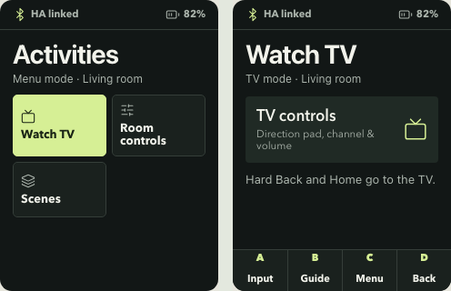

# Activities and Watch TV visual target

This slice restores the visual detail of the approved 240 × 320 design on the two primary screens. The color-correction trial confirms the palette path separately. Judge this slice by the hierarchy, icons, focus, and caption treatment as a whole. The approved key routing still applies. [Design guide](handheld-menu-spec.md#controls-by-mode) · [Palette bench checks](handheld-native-polish.md#palette-comparison-from-photos)

The image shows the approved browser design at native pixel dimensions. Link, battery, and room context are sample data. Reserve y 0–32 and display those values as they become available from a verified source.

Use the [combined native menu checklist](handheld-combined-cut.md) for the corresponding nested menus, read-only Climate, and four-color splash.

## What to render

Coordinates are `x, y, width, height` on the LCD. Use the approved charcoal, lime, primary text, and secondary text roles. [Palette and display spec](handheld-menu-spec.md#240--320-display)

| Detail | Native target | Renderer and asset plan |
| --- | --- | --- |
| Title and mode | Both screens use title `14,45,212,32` and mode `14,79,212,22`. The title should read first at a glance. | Reuse the larger stock menu face and compact stock face. Their hierarchy is visible in the physical Activities photo. The browser face is a visual reference. |
| Activities grid | First row `14,104,103,68` and `123,104,103,68`. Scenes at `14,178,103,61`. Use 5 px corners and 6 px gutters. Align icon and label 9 px inside each tile. Leave the fourth cell and footer blank. | Reuse the three tile labels, stock fill and radius, and two-line **Room controls**. Verify the stock left-padding path before setting local text padding on a reused label. A 1 px idle outline uses divider color `0x31E7` once the setter is verified. The 6 px gaps give separation with existing calls. |
| Activities icons and focus | Put a 16 × 16 TV, sliders, and layers mark above their respective labels. Only the selected tile has a full lime fill. Its icon and label are dark. Idle marks are muted. | Reuse the native indexed-image object path from the splash. Give each mark a color variant for idle and focus. Change the icon with the label when focus moves. |
| TV controls panel | `14,106,212,73`, 4 px corners and fill `0x2144`. Set **TV controls** and **Direction pad, channel & volume** at x 26 near y 118 and 141. Put a 24 × 24 lime TV mark at `189,130`. The secondary line about hard Back and Home starts at x 14 near y 189. | Reuse stock labels and fill calls. A full panel needs a surface and separate compact labels for primary and secondary text. Keep the feedback area at y 253 available for receipts. The text-only probe reused the idle feedback label while receipts were unavailable. |
| TV footer | y 274–319, key centers x 30, 90, 150, and 210. Stack **A / Input**, **B / Guide**, **C / Menu**, **D / Back**. Separate slots with a thin rule or the existing 2 px gaps. | Reuse the four existing caption labels at `60 × slot + 1,274,58,46`. With the 16 px stock line height, 7 px top padding centers two lines. Use lime for letters and primary text for actions when per-line styling is verified. One primary color works with the existing label API. |

## Firmware budget and evidence

The [handheld artwork budget](handheld-asset-budget.md) sizes the full splash, reusable icon family, and menu illustrations for larger verified storage.

- The color candidate contains a **458,540-byte DSP** with **212 bytes** before the verified `0x70000` boundary. A temporary text-only probe added a TV controls note and centered two-line captions using existing objects. It passed the Xtensa palette, navigation, and TV packet fixtures at **458,616 bytes**, leaving **136 bytes**. This measures the text fallback. The image, panel treatments, and left-inset tiles are the full visual target.
- The earlier splash candidate displayed a stock LVGL 2-bit indexed image. Its encoder and 12-byte descriptor are reusable. Start with icon mattes in the exact tile colors to use the proven opaque image path. For three 16 × 16 marks in two states and one 24 × 24 TV mark, budget **640 bytes** of image data including palettes and **84 bytes** of descriptors. The **724-byte** estimate excludes code, alignment, and LVGL object RAM. The full slice needs recovered DSP space or verified asset storage. Validate multiple image objects on the menu page and their teardown before accepting that path. [Native indexed splash evidence](../firmware/dsp-v48-native-menu/SPLASH.md#artwork-and-memory)
- The 240 × 320 panel and stock renderer have displayed styled text, flat fills, and indexed artwork. The missing artwork and sparse TV body were choices for the first candidate's budget. Open renderer checks cover multiple images on the menu page, local padding and outlines, and per-line caption styling. Exact web typography, a new font atlas, and additional live status are outside this slice.

### Offline screen builds

Each row uses the pinned stock-based `--handheld-color` baseline. Free bytes are measured against the existing 112-sector DSP extent (`0x70000`). Code includes Xtensa literal pools. The table gives the extension's C object sections and the final linked DSP size, which also includes alignment.

| Build | Code | Read-only data | DSP bytes | Free bytes |
| --- | ---: | ---: | ---: | ---: |
| Color candidate | 1,139 | 438 | 458,540 | 212 |
| Activities glyphs and stacked TV key captions | 1,223 | 488 | 458,656 | 96 |
| Same, with a two-line TV controls note | 1,243 | 532 | 458,720 | 32 |
| Packed menu with read-only Climate placeholder | 1,311 | 386 | 458,660 | 92 |
| Packed menu with Climate and preformatted temperature updates | 1,395 | 397 | 458,752 | 0 |
| Packed menu with Climate and stock numeric formatter | 1,459 | 411 | 458,828 | −76 |

The smallest visual slice with icons uses the existing stock font at `0x20060a70`. Its video, settings, and list glyphs sit above left-inset labels. The stacked A–D captions reuse the four existing TV labels. The note variant reuses the feedback label. These two builds passed the Xtensa fixture for native color encoding, layout, navigation, and the TV key frame. The glyph slice adds four local left-padding properties across the reused slots, with no new LVGL objects or static data RAM. `draw` retains its 48-byte C stack frame. The offline source patch is `handheld-glyph-slice.OFFLINE.patch`, SHA-256 `d810e19db89a03acdd57a25284cbdc4a8be9d6eb5e212113793d63189f610339`. Apply it to a copy of the native-menu sources and build with `--handheld-color --smoke`. Its DSP SHA-256 is `77546fd49463bdd9704c783ed242a873bd79f1350a205886cfc450c3c5a9426f`.

The Climate placeholder uses the existing labels for **Current temperature**, **--**, and **No reading yet**. Compact menu descriptions saved 56 linked bytes before the screen was added. The fixture checked entry and Back, the missing reading, and the absence of a Climate command. The separate preformatted-value fixture rendered current and last-known values from test strings. Combining the placeholder with the stock-glyph slice also measures exactly 458,752 bytes. The placeholder adds no objects or static data RAM and increases the `draw` frame from 48 to 64 bytes. The stock numeric-formatter build was measured by linking its sections. A physical inbound carrier, state allocation, and freshness handling remain open. [Proposed state protocol](../firmware/dsp-v48/PROTOCOL.md#proposed-screen-snapshots-and-state-updates)

### Restoring the original startup splash

The current Activities candidate uses a different page initializer and opens directly into the menu. The earlier Home/Controls candidate used a 48 × 76 icon and stock-font wordmark. For the combined cut, use the approved four-color full-size splash stored in three crops. The first eligible fresh press should dismiss the splash to Activities and be consumed through release. If no key is pressed, the one-shot timer should open Activities after about three seconds. Confirm power and KATA retain stock handling and measure pickup separately, since pickup can restart the DSP. [Approved crop layout](handheld-asset-budget.md#compact-splash-packing) · [Earlier splash behavior and bench result](../firmware/dsp-v48-native-menu/SPLASH.md)

Rebuilt the original menu and splash DSPs and matched both candidate binaries byte for byte. The historical splash increased the linked DSP from **457,176 to 458,676 bytes**, a **1,500-byte** addition. Of that, **928 bytes** are indexed art and palette, **12 bytes** are its image descriptor, **540 bytes** are code and literal pools, **17 bytes** are label strings, and **3 bytes** are link padding. The stock image class requests 60 bytes for its instance. The one-shot timer requests 24 bytes plus 8 bytes for its list links. That accounts for **92 bytes of heap requests** before child-list, text, style, and allocator overhead. Each historical splash function has a 32-byte C stack frame before nested calls. The earlier build used two state bytes in the startup alignment word. The color menu uses three of that word's four bytes, so combining both paths requires packing the startup flags and verifying their transitions.

The historical art and descriptor alone exceed the color candidate's remaining DSP space by **728 bytes**. Its 1,500-byte linked delta would put the color candidate **1,288 bytes** over the current extent and the glyph slice **1,404 bytes** over. The full-size splash expands to **5,744 bytes** of native crops at runtime. The separate combined cut stores it losslessly within retired DSP regions and passed the offline fixture. [Corrected candidate and digests](handheld-native-polish.md#stock-color-path-and-corrected-build) · [Combined cut verification](handheld-combined-cut.md#offline-build-result)

## Physical acceptance

Compare Activities with each first-row tile focused and Watch TV with A–D in frame, at normal and dim backlight. The title and mode read in order. Every tile has a recognizable mark and complete text. Exactly one lime tile follows focus, including its dark icon and label. The TV panel sets a clear middle region and all four captions sit over their keys. Confirm local D and device Back retain the guide's behavior.
