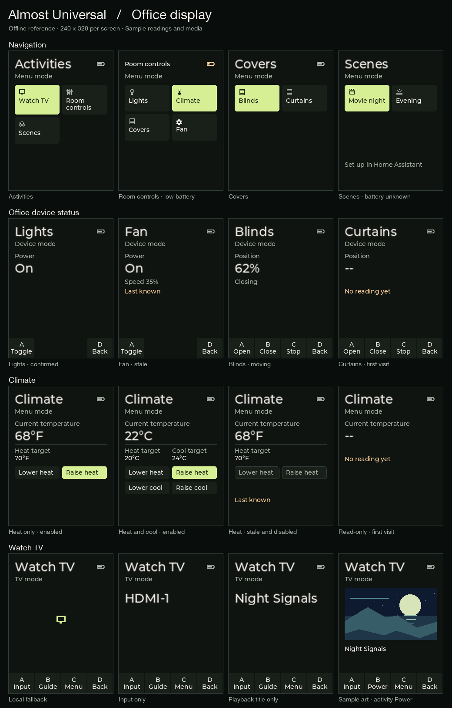

# Office display and Watch TV activity

This is the next 240 × 320 layout for the fixed Office profile. The header, browse screens, and local Watch TV fallback use stock assets and local battery data. Climate adjustments, live readouts, and media require separately verified Home Assistant paths. The reference uses sample readings and artwork, stock compact glyphs, and a size proxy for the larger font. The screens were rendered offline.

## Shared header and keys

Coordinates are `x, y, width, height` in native LCD pixels. Use the stock font and RGB565 palette from the combined cut.

| Element | Bounds | Treatment |
| --- | --- | --- |
| Title | `14,14,174,32` | Left-align the stock menu face when measured ink fits. Otherwise use the compact face in one line at y 22. Keep built-in titles whole, including **Room controls**. Truncate authored titles at a glyph boundary with `...` if they exceed the compact width. |
| Battery | `198,22,28,18` | Center one 18 × 10 stock battery glyph. Use secondary `0xADB5` from 21% and amber `0xFE93` at 20% or below. |
| Mode | `14,50,212,22` | **Menu mode**, **Device mode**, or **TV mode** in secondary compact text. |
| Content | `14,78,212,170` | The page body starts 6 px below the mode box. |
| Feedback | `14,253,212,21` | One compact line when needed. This space stays available independently of the battery and of the body. |
| A–D strip | `60 × i + 1,274,58,46`, for i = 0–3 | Center the letter and action as two 16 px lines with 7 px top padding. Hide unassigned slots and the entire strip in cursor menus. |

Measure with the stock menu face at `0x001CA068` and compact face at `0x20060A70`. The title ends at x 188, leaving 10 px to the battery. Reuse the stock local ARM-to-DSP battery report. The received value must be an integer from 0 to 100. Leave the slot empty until an actual valid report arrives. A valid 0% uses the empty icon, and a startup zero in uninitialized cache is absent. For 88–100, 63–87, 38–62, 13–37 and 0–12, use `U+F240` through `U+F244` respectively. Refresh the visible glyph or color on change without disturbing focus, feedback, or content. Verify this on every page after splash and across navigation. [Stock battery report and existing Activities implementation](../firmware/dsp-v48-native-menu/patches/README.md) · [Native fonts and palette](handheld-combined-cut.md#1-apply-the-stock-font-roles-and-palette)

Cursor pages use D-pad, OK and physical Back. Device pages use their mapped keys. D is local Back on device pages and restores the parent focus. The Office device pages also accept physical Back. Watch TV physical Back and Home route to the configured navigation target. Power buttons, KATA and Reset keep stock behavior. Entry, repeats and release must never replay the press that opened a page. The approved boot splash retains its exact four-color art and crop positions. [Office key contract](progress-2026-11-20.md#verified-on-the-v06-spare) · [Approved splash and crop layout](handheld-combined-cut.md#4-include-the-approved-splash-and-verify-the-linked-build)

## Browse pages

Use 103 px columns at x 14 and 123, a 6 px gutter, 5 px corner radius and one lime focus fill. Place the existing 16 × 16 Office bitmap at tile offset `9,8` and its label at `9,28`. Keep the Fan glyph and label in their existing compact two-line treatment at offset `9,11`.

| Page | Placement | Tile order |
| --- | --- | --- |
| Activities | Row 1 y 78, h 68. Row 2 y 152, h 61. | Watch TV, Room controls (two lines), Scenes. |
| Room controls | Rows y 78 and 145, h 61. | Lights, Climate, Covers, Fan. |
| Covers | Row y 78, h 61. | Blinds, Curtains. |
| Scenes | Row y 78, h 61. | Movie night, Evening. Keep existing setup feedback in the bottom feedback line when applicable. |

## Office device status

Use a compact secondary label at `14,78,212,18`, the primary value at `14,98,212,32`, an optional compact detail at `14,137,212,18`, and a freshness line at `14,159,212,20`. Prefer the measured large face for the main value. Use the compact face if the value exceeds the box.

| Device | Status | Fixed action keys |
| --- | --- | --- |
| Lights | **Power** with **On** or **Off** from `light_power`. | A Toggle, D Back. |
| Fan | **Power** with **On** or **Off** from `fan_power`. If on and a valid `fan_speed` percentage is available, add **Speed 35%** using the reported value. | A Toggle, D Back. |
| Blinds and Curtains | **Position** and a valid `cover_position` percentage. Show a confirmed `cover_state` as detail when present. If only the cover state is valid, label it **State** and show **Open**, **Closed**, **Opening**, or **Closing** as the main value. | A Open, B Close, C Stop when supported, D Back. |

Retain the last confirmed value with **Last known** after link loss or freshness expiry. Show **--** and **No reading yet** before a valid sample, and **--** and **Unavailable** following explicit unavailability. These hints use amber and spell out the condition. Optional details clear when unavailable or irrelevant. Keep stock Stop captions in the fixed profile until capabilities are known. On a capability-aware page, leave C blank if Stop is unsupported and keep D in place. A missing readout alone does not disable an otherwise working Office binding. A successful button press or receipt must never update the displayed device state by itself.

## Climate

Climate keeps cursor navigation under Room controls, with physical Back and a blank footer. Show current room temperature and its reported unit above the targets. On the existing fixed profile the page is read-only. Enable the target tiles once the supported action and confirmation paths are present.

| Element | Bounds |
| --- | --- |
| **Current temperature** | `14,78,212,18` in the compact face. |
| Measured value | `14,98,212,32` using the large face if it fits. |
| Divider | `14,133,212,1` when target readouts are present. |
| Targets | x 14 and 123, w 103. Labels y 140, h 16. Confirmed values y 157, h 16. |
| Action tiles | x 14 and 123, w 103, h 29, radius 5. Row 1 y 184. Row 2 y 219 in Heat/Cool. Place compact text at tile offset `9,6`. |
| Freshness and action feedback | Use y 159 on the read-only page with no targets. When targets are present use the shared feedback line. |

| Confirmed HVAC mode | Targets | Action order |
| --- | --- | --- |
| Heat | **Heat target** in the left target column. | **Lower heat** `heat_down`, **Raise heat** `heat_up`. |
| Cool | **Cool target** in the left target column. | **Lower cool** `cool_down`, **Raise cool** `cool_up`. |
| Heat/Cool | **Heat target** on the left, **Cool target** on the right. | Heat actions in row 1, cool actions in row 2, each lower then raise. |
| Off, unsupported, or mode unknown | Current reading only. | No action tiles. |

Use `room_temperature`, `heat_target`, and `cool_target` readouts. HA owns the thermostat selection, reported unit, limits, step, and Heat/Cool range guard. Derive each requested step from the latest confirmed target. Preserve the other endpoint in Heat/Cool. Keep the displayed target at its confirmed value while a change is pending. Confirm it with a fresh state sample. A missing current reading can coexist with a valid target. Use **No room reading** or **Room temp unavailable** in the feedback line when a target is visible and only the room field is missing or unavailable.

Disable individual tiles at their limit or when the relevant mode, target, range, binding, or link cannot support the action. Retain stale readings with **Last known** and disable the stale target's tiles. Draw a disabled tile with secondary text and the divider outline. Skip it during navigation. Start on the first eligible tile in row order and keep focus on the current tile while it remains eligible. If it becomes disabled, move to the first eligible tile, or clear focus if all are disabled. A fresh OK press on an eligible tile requests one step. [Current state and freshness plan](handheld-state-plan.md#read-only-exchange)

## Watch TV

Use the shared **Watch TV** title and **TV mode**. Give the body to actual information and keep the keys in their original strip. Omit the old controls heading, key tutorial, and hard Back/Home hint.

| Available content | Native treatment |
| --- | --- |
| Title with art | Fit the art within `14,78,212,120`, preserving aspect ratio and centering on the panel matte. Use `14,210,212,36` for up to two compact title lines. |
| Art without title | Use the same art box. Use the confirmed source label under the art if available. |
| Text only | Use `14,86,212,52`. Show a confirmed playback title first, then fall back to the Vizio active app, then to its current input. Use the large face for a measured one-line fit, otherwise wrap to two compact lines and ellipsize at a glyph boundary if needed. |
| Explicit TV power off | Clear media and show **TV off** in the text-only box. |
| No usable state or media | Center the existing 24 × 24 TV mark at `108,139,24,24` on the panel color. Use this same fallback in the visual-only build. |

Keep Vizio app and input separate from the independently selected **Now playing** entity. If playback goes stale, drop stale title/art and fall back to fresh Vizio app/input. Match art and text to the same playback item, page activation, and current session. Drop art that belongs to an earlier item. A missing or rejected asset leaves the available text visible. HA resolves, sizes, and bounds optional artwork before it can reach the remote. Send a verified bounded asset reference through a supported path. A future 212 × 120 image at 4 bpp takes 12,720 B of pixel data before its palette, descriptor, transfer staging, and rendering memory. The fixed build needs only the small stock TV mark.

### One activity, separate targets

In the HA builder, show the current target beside each group. Allow a per-key override and show the resolved target when the user selects a button in the preview. Keep target names in the builder. Put the action name on the remote.

| Builder group | Example route | Remote behavior |
| --- | --- | --- |
| **Navigation** | Apple TV | D-pad, OK, Back and Home. C Menu can use the same target. |
| **Volume and mute** | AVR | Physical Volume +, Volume − and Mute. |
| **TV input and status** | Vizio | A Input can target the TV. Use the TV's reported power, app or input for the content fallback. |
| **Activity power** | Script or automation for Vizio, Apple TV and AVR | Assign **Power** to one utility slot. The example uses B in place of Guide. Keep the other eligible keys and D Back. The script owns the component commands. |
| **Now playing** | Optional playback entity, for example the Apple TV media player | Supplies title and available art. This selection only changes the readout. |

The fixed profile shows **A Input · B Guide · C Menu · D Back** and already resolves eligible TV keys through Home Assistant switch or script bindings. Use individual scripts to target navigation and volume where needed. Enable the **B Power** variant only on a profile that can display the matching caption. In draft v1, Power can use the existing script action, including a script that invokes an automation. A direct automation action or direct device commands require a supported action kind. While editing, show the selected action and destination together, for example **Volume + → AVR** or **B Power → Watch TV power**. Distinguish the **Now playing** selector as a readout source and show stock/unassigned keys as such. The preview simulates each binding and keeps D local even without HA.

## Home Assistant draft and display contract

- The shared draft uses stable page, control and display slot IDs. Use the existing `soft_1`–`soft_4` controls, hard-key names, `device` mode, `back: true` for local D, and action kinds the runtime advertises. Entity IDs, scripts and routing stay in HA. The device sees display content, labels, local routes, and advertised action slots. [Handheld menu draft v1](handheld-menu-draft-v1.md)
- The fixed Office preview keeps its cursor grid and Climate action order. The portable v1 `menu` mode currently uses soft-key controls. An editable cursor grid needs an explicit schema capability before the builder can export it. Use the same readout formatting and simulated target adjustment in both previews, and keep each profile's physical input rules visible.
- The v1 readout kinds support the Office and Climate fields above, plus TV power, volume and mute. Vizio input/app, a separately selected playback entity, and playback title/art need explicit metadata support. Use the local TV mark until the corresponding data is available. Keep existing Office control IDs and avoid assigning new Climate wire IDs here.
- Bind confirmation to the relevant page, entity and session. Reject late snapshots from prior pages or playback items. The authoring preview labels simulated values and exposes draft-only sync status until the active layout can be verified on the handheld. [State plan](handheld-state-plan.md) · [Office key and source IDs](progress-2026-11-20.md#verified-on-the-v06-spare)

## Acceptance

| Check | Expected result |
| --- | --- |
| Header across every page | Title and battery never overlap. Room controls fits in the compact face. Missing, low, zero and changing charge leave the title, focus and active feedback stable. Check both backlight settings with the stock fonts. |
| Local navigation | D-pad and OK work on cursor pages. Physical Back restores prior focus. In Watch TV, physical Back/Home route to the navigation target and D returns locally with or without HA. An entry press sends no action. |
| Office device status | Fresh, stale, never-received and explicitly unavailable each show the right text. Test Fan power and speed independently, Covers position-only and state-only, and unsupported Stop. |
| Climate | Current and target differ in the same capture. Check °C, °F, Heat, Cool, Heat/Cool, bounds, unavailable values and pending confirmation. Verify disabled tiles can neither receive focus nor send a command. |
| TV independent routing | Compare local mark, input/app only, title only, art with title, power off and rejected art. Verify that art changes never move the keys. One activity routes navigation, volume/mute and Power to their selected destinations. Power uses its displayed slot and D remains local. Stock ON/OFF and KATA retain their paths. |
| Visual-only DSP | Check the shared header, fixed captions, and local TV fallback on the pinned stock path. Compare the complete splash to the approved RGB565 frame and verify storage, teardown, and recovery with the exact linked candidate. |

The offline reference checks panel dimensions, text bounds with extracted glyphs, battery isolation, Climate focus states, and the fixed TV footer across content variants. It also verifies the repacked splash against all 76,800 approved pixels at RGB565 precision. The panel font fit, battery refresh cadence, input behavior on the target DSP, and HA data paths still require their respective firmware checks.

The shared-header DSP candidate implements the fixed-profile geometry and local TV mark. Its offline fixture covers all ten screens and stock battery refresh. The separate host runtime proof exercises the draft projection and mock state without using the stock Bluetooth path. [Visual candidate and exact pin](../firmware/dsp-v48-native-menu/patches/README.md)
