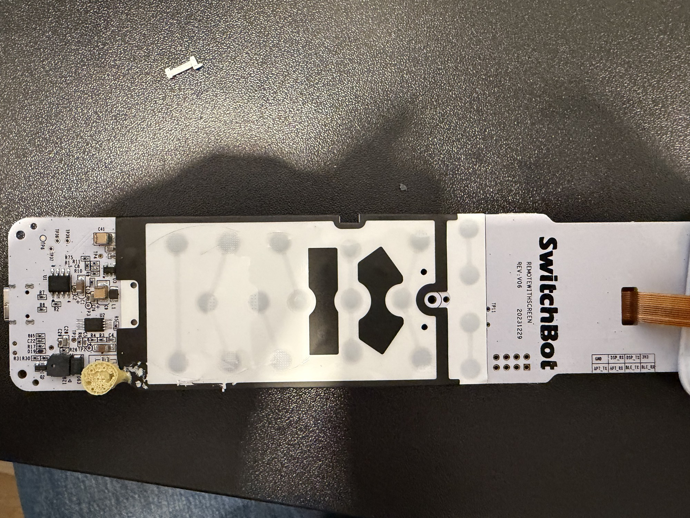
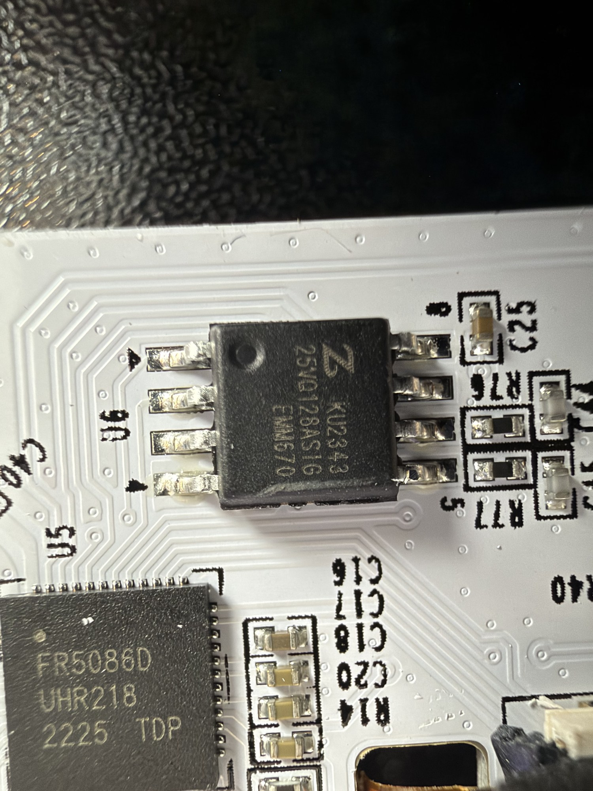
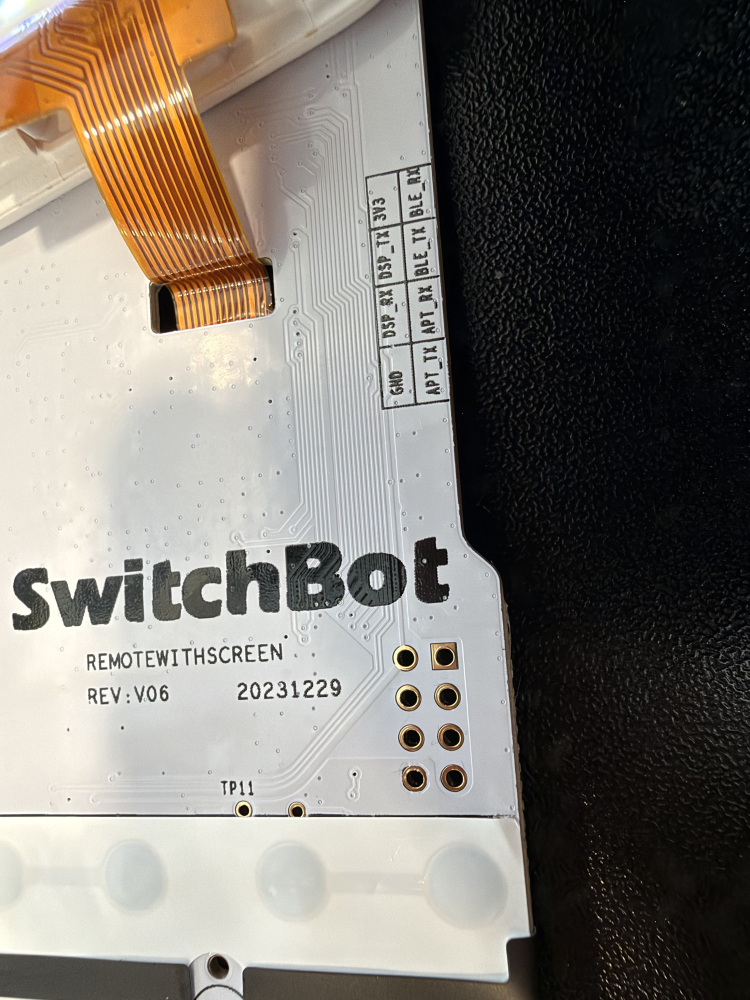
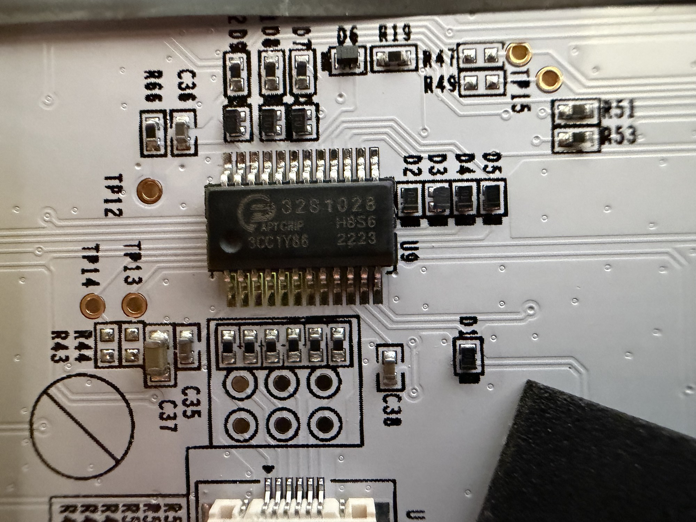

# Hardware and flash capture

The bench unit is a SwitchBot Universal Remote W4600000. Its `REMOTEWITHSCREEN` PCB is marked `REV:V06` and dated `20231229`. The regulatory teardown shows an earlier V05 board. [FCC internal-photo exhibit](https://fccid.io/2AKXB-W4600000/Internal-Photos/Internal-Photos-7109180)

| Location | Identification |
| --- | --- |
| U5 | FreqChip FR5086D. The stock images contain Cortex-M Thumb and little-endian Xtensa code. |
| U6 | Zbit `25VQ128ASIG`, a 128 Mbit (16 MiB) SPI NOR chip. The reader observed JEDEC ID `5E 40 18`. [Zbit SPI NOR specifications](https://www.zbitsemi.com/en/display.php?id=17) |
| Eight-hole header | Silkscreen identifies separate DSP, BLE, and APT UART signals. Bench measurements established ground continuity to the USB-C shell, approximately 3.065 V at the marked supply, and approximately 3.387 V at DSP_TX while awake. |

## Board photos

| Button side | Processor and flash | Serial header |
| --- | --- | --- |
| [](../images/button-side.jpg) | [](../images/processor-and-flash.jpg) | [](../images/serial-header.jpg) |

| End of board | Connector detail | Battery and flex connectors | Test pads |
| --- | --- | --- | --- |
| [](../images/end-of-board.jpg) | [](../images/connector-detail.jpg) | [](../images/connector-and-battery.jpg) | [](../images/test-pads.jpg) |

## UART observations

The button-side header has this silkscreen layout with USB-C on the left and the IR end on the right. The square through-hole is at the lower right in this orientation.

```text
GND      DSP_RX   DSP_TX   3V3
APT_TX   APT_RX   BLE_TX   BLE_RX
```

A battery-powered remote yielded these DSP messages after a Down press with a receive-only connection at 115200 baud, 8N1. A separate receive-only capture on BLE_TX yielded four repetitions of `freqchip` followed by binary data after reconnecting the battery. APT and the programming interface remain unverified.

```text
BOOT: start up.
freqchipfreqchipfreqchip
DSP basic function start running.
```

### V06 bench wiring

Use the labeled eight-hole header for these signals. With the **battery side facing you**, USB-C on the left and the IR end on the right, the square `BLE_RX` pad is at the upper right. [Full battery-side photo](../images/component-side.jpg) · [Header close-up from the button side](../images/serial-header.jpg)

```text
APT_TX   APT_RX   BLE_TX   BLE_RX
GND      DSP_RX   DSP_TX   3V3
```

| SwitchBot pad | Connection used |
| --- | --- |
| `DSP_TX` | ESP32 `GPIO16` in the original receive-only sketch. For the successful 115200 8N1 captures, move this lead to the old ESP8266 board pin marked `TX`. On that specific board `TX` goes to the onboard CP2102 receiver with ESP8266 `EN` held low. |
| `BLE_TX` | ESP32 `GPIO32` during the earlier diagnostic. The ESP8266's CP2102 also listened here as a separate trial, before it was moved to `DSP_TX`. |
| `BLE_RX` | ESP32 `GPIO33`, configured as a high-impedance input for the voltage and receive-only checks. Leave this pad open for DSP logging. |
| `GND` | Common ground between the remote and whichever receiver is in use. |
| `DSP_RX`, `APT_RX`, `APT_TX`, `3V3` | Open during receive-only logging. The remote runs on its battery and the ESP board takes power from USB. |

The BLE checks measured approximately 5 mV on `BLE_RX` and 3.36 V on `BLE_TX` with the board powered. With power off, GND had continuity to ESP32 GND and neither BLE signal produced a continuity beep to ground. These checks leave the routes to the tiny U5 package pads unconfirmed. The v4.8 BLE captures on both receivers yielded no repeatable `freqchip` greeting and no completed MCU downloader handshake. For DSP logging, a plain recessed Reset with KATA released, followed by Down to wake the screen, reproduced the startup trace with the battery connected. [Verified DSP receive setup and markers](../firmware/dsp-v48-uart/README.md)

## Reading U6

The [ESP32 sketch](../tools/u6_esp32/u6_esp32.ino) is the current reader. It expects a classic ESP32 with an Arduino-ESP32 3.x core and uses only the flash identification and read commands. It verifies each SPI burst against an overlapping read, then sends 4 KiB blocks with a CRC and acknowledgment over USB for long captures. The host tracks ordering, saves interrupted reads as `.part` files, and prints the SHA-256 once a range completes. It can log DSP UART and passively count U6 bus activity between reads. The earlier [ESP8266 reader](../tools/u6_reader/u6_reader.ino) and [activity probe](../tools/u6_activity/u6_activity.ino) record the first bench approach.

| ESP32 GPIO | Bench signal |
| --- | --- |
| GPIO27 | U6 CS# |
| GPIO18 | U6 SCLK |
| GPIO19 | U6 SO / MISO |
| GPIO23 | U6 SI / MOSI |
| GPIO16 | DSP_TX via receive-only UART |
| GND | Common ground |

These are firmware pin assignments. The in-circuit SPI bus can also be driven by the remote. Check signal levels, power source, and bus ownership on your board before driving the bus. The reader defaults to SPI mode 0 at 100 kHz and USB serial at 460800 baud.

With the reader sketch installed on the ESP32 and the serial port identified, `id` checks the chip and `sample` reads the first 4 KiB. Use distinct filenames for independent captures.

```sh
mkdir -p captures
PORT=/dev/cu.usbserial-EXAMPLE
python tools/u6_esp32/capture.py id --port "$PORT"
python tools/u6_esp32/capture.py sample --port "$PORT" --out captures/sample.bin
python tools/u6_esp32/capture.py dump --port "$PORT" --out captures/u6-read-1.bin --timeline captures/u6-read-1.jsonl
```

Use [`live.py`](../tools/u6_esp32/live.py) to keep one connection open for diagnostics, 1 MiB sections, or 4 KiB-aligned address ranges. Run `python tools/u6_esp32/watch.py captures/u6-read-1.jsonl` from another terminal to follow the example capture without opening a second serial connection.

## Completed v4.6 capture

The ESP32 captured all 4,096 blocks in order for a total of 16,777,216 bytes. The SHA-256 is `6ce13a79ffc94b01de0df29044c1529df08ff88969d37fe3cbacaa278c60964b`. The first 2,088,960 bytes match an earlier ESP32 capture. The earlier ESP8266 capture differed. During the full capture the host recovered from malformed USB frames by withholding acknowledgment until a valid retransmission arrived.

| U6 physical offset | Verified contents |
| --- | --- |
| `0x000000` | Exact stock v4.6 `DSP.bin` |
| `0x080000` | Exact stock v2.7 `DSP.bin`. A saved copy record identifies this as the source of a prior flash copy. |
| `0x100000` | Exact stock v4.6 `RES.bin`, also identical in v4.7 and v4.8 |
| `0x800000` through `0xFFEFFF` | LittleFS settings and configuration volume with 2,047 blocks of 4 KiB |
| `0xFFF000` | Sector containing the flash copy record |

The stock v4.6 `ARM.bin` had no exact contiguous match in U6. An independent full read and a U6 restore are still pending. Keep raw dumps and timelines local because they can contain provisioning and personal configuration.
