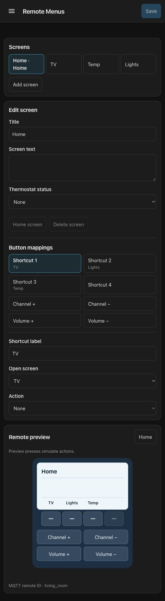

# Home Assistant activity remote

Home Assistant owns activities, menus, and button mappings. The replacement firmware renders a title and optional status text. The editor preview places up to four shortcut labels inside the display, directly above their physical keys. The current ARM build is a bench prototype for screen rendering, local input, and Bluetooth. Handheld IR and power management remain work in progress. [Firmware status](../firmware/v06/README.md)

## Set up the menu editor

1. Copy the repo’s `custom_components/ununiversal_remote` folder into your Home Assistant config directory under `custom_components`, then restart Home Assistant.
2. In **Settings → Devices & services**, add **The Ununiversal Remote**. Give your remote an ID such as `living_room`. Use this ID in the MQTT client too.
3. Open **Remote Menus** in the sidebar. The home screen, Activities, starts with TV in the first slot. On TV, use Lights, AC Control, Blinds, and Off. Assign your light to Lights, pick your thermostat on AC Control, and assign your shutdown script to Off. Off returns to Activities. Back on AC Control returns to TV.
4. Try the draft in **Remote preview**, then save it. The preview follows navigation and shows the action that would run. Saved menus are kept in Home Assistant and restored on restart.

Any binding can open a screen, run an action, or do both. The action choices include toggling a light or switch, running a Home Assistant script, activating a scene, or adjusting a thermostat. Bluetooth actions run in Home Assistant. Use a Home Assistant script for IR through an HA-managed blaster, or use the named IR command for the legacy MQTT simulator. A script can coordinate several devices.

<details>
<summary>See the Remote Menus editor and four-key preview</summary>



</details>

On AC Control, Channel changes the heat target and Volume changes the cool target. In heat/cool mode both targets are sent together. The display shows the state that the thermostat reports back, and each queued adjustment reads the confirmed state. In a single heat or cool mode, only the matching keys change its setpoint.

## Connect a Bluetooth handheld

1. Let Home Assistant discover the powered handheld using its Bluetooth integration. Use an existing connectable adapter or an active ESPHome Bluetooth proxy in range. [Home Assistant Bluetooth](https://www.home-assistant.io/integrations/bluetooth/) · [ESPHome Bluetooth proxy](https://esphome.io/components/bluetooth_proxy/)
2. Open the discovered **The Ununiversal Remote** integration. Optionally select a switch in **First switch** to start with a one-button Home menu. On an existing integration, choose the handheld from **Configure**. Keep **Bluetooth off** to continue with the MQTT simulator alone.
3. In **Remote Menus**, edit the shortcuts or open **More physical keys** to bind hardware controls on a screen. Soft key D and the hard Back key are editable. **Export saved menu** downloads the exact handheld menu as `menu-<revision>.urm`. When connected, the integration synchronizes the saved menu automatically.

For the first switch check on an existing installation, add a test screen or use an empty slot on an existing screen. Choose **Shortcut 1**, enter **Lights** as the label, set **Action** to **Toggle switch**, and pick a test switch. Choose **Press** under **Run action on**. Link the new screen from a free Home slot if needed, then save. Tap A once to toggle the light and a second time to restore it. Holding A and releasing it should produce one toggle in total. The preview simulates the result.

### Bluetooth wire contract

The service UUID is `13f70001-7e61-4c69-9a28-9d39a8d01001`. Replace `0001` with `0002` for the control characteristic (write with response), `0003` for input notifications, and `0004` for status reads. Integers are little-endian. Home Assistant uses control writes up to 20 bytes for the minimum ATT MTU.

- **Menu** starts with `URM1`, screen count (u16), and home index (u16). Screens are sorted by ID and use one-based indices. Each screen contains title, static body, and four captions (one byte of UTF-8 length before each string), followed by twenty u16 destinations in control ID order. A zero destination stays on the screen. Maximums are 8,192 bytes, 64 screens, and 64/255/32 UTF-8 bytes for title/body/caption.
- **Revision** is the first eight bytes of SHA-256 over the normalized menu serialized as compact UTF-8 JSON with sorted keys. The hash includes Home Assistant action bindings and trigger choices.
- **Input** is `<IHBb`: source screen before navigation, control ID (1–19 are the firmware key profile indices plus one, 20 is the wheel), kind (1 press, 2 release, 3 hold, 4 repeat, 5 turn, 6 item activation), and signed wheel steps. The HA event `ununiversal_remote_input` exposes these as `screen_id`, `control_id`, `button_id`, `kind`, and `wheel_steps` along with `remote_id`. Disconnected input stays local.
- **Status** is `<BB8sI`: version 1, active flag, revision, and current screen index. The central verifies status before accepting input after a connection or saved-menu change.
- **Control** begins with opcode `01` + revision and u16 total size, followed by `02` + u16 byte offset and data chunks, then `03` to commit. `04` + revision activates the session on every connection or menu change. `05` + u32 current screen index + u8 byte offset sends live thermostat text in UTF-8 segments. Offset zero replaces the current live text.

## MQTT and the simulator

Configure the built-in MQTT integration first for live presses. If you add MQTT after setting up the remote, reload **The Ununiversal Remote** from Devices & services. The editor preview also works during a broker disconnect.

```sh
python -m pip install paho-mqtt
python tools/simulate_remote.py mqtt.example.local living_room --username your-user
```

At the prompt enter `soft_1` to open TV and `soft_2` to open AC Control. Enter `channel_up 3` to send three presses, or `ready` to request the current screen. Navigation replies include the measured MQTT round trip in the terminal. With a TLS-enabled broker use `--tls` and optionally `--port`.

All topics use the prefix `ununiversal_remote/<remote_id>/`. Use non-retained messages at QoS 0 and credentials scoped to the remote’s topics where the broker supports it.

| Topic suffix | Publisher | JSON example |
| --- | --- | --- |
| `ready` | Remote | `{}` |
| `press` | Remote | `{"screen_id":"tv","screen_token":"ec5pizcYLrI","button_id":"soft_2"}` |
| `screen` | Home Assistant | `{"screen_id":"ac","screen_token":"sNqcF6A8cdw","title":"AC Control","text":"Room 72°F\nHeat 68°F\nCool 74°F","buttons":{"soft_4":"Back"}}` |
| `ir` | Home Assistant | `{"command_id":"tv_power_off"}` |

Subscribe to `screen` and `ir` before sending `ready` on wake or reconnect. Each press carries the screen ID and token that were displayed at the time. Use `soft_1` through `soft_4`, `channel_up`, `channel_down`, `volume_up`, or `volume_down`. Blank shortcut slots stay empty. Keep the token with the screen. Navigation and saving generate a new token, and text updates reuse it. Home Assistant responds to a stale press with the current screen. The handheld can map IR command IDs to its locally stored codes when its IR path is ready.

## Verify the implementation

On a test Home Assistant server, assign the sample Off mapping to a test script and confirm it runs from a live MQTT press. Check that the preview reports the script without running it, and that a rapid burst of Channel presses moves the heat target without changing the cool target. Test a reconnect and confirm that menus survive a Home Assistant restart.

Run the menu regression tests from a Python environment with Home Assistant installed and a C compiler on the path. The Bluetooth tests compile the handheld's key sampler and menu runtime, then feed their actual notifications through the production Home Assistant dispatcher with a simulated switch.

```sh
python -m unittest discover -s tests -v
```

The next hardware milestone tests discovery and the one-button switch action through an existing adapter or active proxy. Measure button-to-display latency on the handheld, aiming for under 150 ms at the 95th percentile while connected. Measure the first press after sleep separately.
